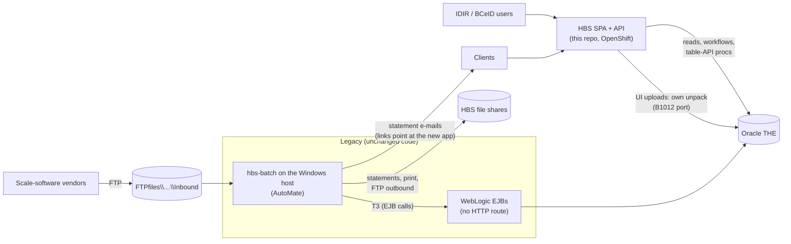

# Coexistence: new UI, legacy batch

**Decision (2026-10-21):** the legacy web UI is switched off (its route
removed) while the legacy batch keeps running. This app becomes the only UI,
and builds whatever batch pieces that requires. FTP intake and FTP/print
delivery stay in legacy batch until vendor change management moves them to a
modern channel.

## What runs where



| Function | Runs in | Notes |
|---|---|---|
| All screens, searches, reports | new app | |
| Workflows (summary/detail returns, profiles, rating, sampling, billing admin, scale control) | new app | ported EJB logic, [workflow-porting.md](workflow-porting.md) |
| Web XML upload (P505) | new app | **own unpack** (B1012 port) for files uploaded in the new app; ends at UNPACKING/SUCCESS, where legacy B1021 picks it up |
| FTP XML intake (B1011 → B1012) | legacy batch | unchanged; legacy B1012 only scans the `XMLinput` share, so the two unpacks never see each other's files |
| Edits, summarize, audits, waste, invoicing, statements, ratios (B1021 → B2042) | legacy batch | DB-driven; they process rows written by either UI the same way |
| Statement delivery (B2065) e-mail / FTP / print | legacy batch | e-mail links point at the new app (`statement.delivery.webapp.url`), which rebuilds the files from Oracle |
| Statement / invoice downloads | new app | rebuilt from `HBS_FILE` (XML) and rendered to PDF (FOP + the legacy XSL) |
| Processing parameters (P038) | settings ConfigMap (edit) → legacy batch (read) | the settings ConfigMap (below), copied to the legacy files by the share bridge; read-only in the new app |
| Scaler keys, HBS public key download | new app | needs the keys from Security (Q9) |
| Scaler signature verification | legacy batch (B1021) | legacy B1012 never verified signatures, so the new unpack needs no keys; it stores hash, encrypted signature, key id and padding id as legacy did |

## Hazards and how each is handled

| Hazard | Handling |
|---|---|
| Legacy B1012 resets every transmission at UNPACKING/PROCESSING when it starts (`removeAbnormalTerminations`), deleting its batches | The new unpack does a whole transmission in **one transaction**, so UNPACKING/PROCESSING is never committed and legacy never sees it |
| Two writers on the same rows (new UI vs legacy batch) | `RowLock` on `UPDATE_TIMESTAMP` in every workflow; legacy entity beans use `concurrency-strategy Database` (re-read each transaction), so the new app's writes are seen |
| Legacy in-memory reference cache (`infrastructure/cache/Cache.java`: timber marks, scale sites, population strata, scaler licences; `cache.enabled=true`, never invalidated) | Legacy config change: `cfg_p_cache_enabled=false`, or a nightly WebLogic restart. Otherwise batch uses stale values after profile edits in the new app |
| Workflow half-done states picked up by a legacy job | One transaction per workflow ([workflow-porting.md](workflow-porting.md) rule 4) |
| Nobody maintains `HBS_USER` once legacy enrolment is gone, yet legacy B2065 e-mails statements to `HBS_USER.EMAIL` of the users in a client location's data domain, and the data domains key on it | `users/HbsUserProvisioning` creates/refreshes the caller's row from the login token (type, active status, names, e-mail, client), keeping the columns the token lacks (phone, middle initial, location, org unit); admins keep assigning client locations in User Services |
| Statement e-mail links pointing at the removed legacy route | Legacy batch config `statement.delivery.webapp.url` → the new app; the new app serves `/StatementDelivery/transmissions/<id>.pdf\|.xml` |
| Processing parameters edited where batch can't see them | Share bridge |

## Legacy changes (configuration only, no code)

1. Remove the legacy web route; keep WebLogic, the HBS EAR and T3 reachable
   from the batch host.
2. `statement.delivery.webapp.url` (batch `hbs_batch.02.properties`, token
   `b_statement_url`) → the new app's base URL.
3. Invoice information link in the same e-mail: `cfg_b_general_info`
   (property `invoice_general_info`) → `<new app base URL>/public/invoice-information`
   (the old `/invoice-information` also works: it redirects there).
4. Reference cache off: `cfg_p_cache_enabled=false` (EAR `configure.properties`),
   or schedule a nightly WebLogic restart.
5. Schedule the share bridge (below) in AutoMate.

## This app's switches at cutover

| Setting | Value | Why |
|---|---|---|
| `HBS_BATCH_ENABLED` + `HBS_BATCH_UNPACK_ENABLED` | `true` | unpack of files uploaded in this app (B1012 port); without it they wait at RCD/CSA |
| OpenShift Secret `<name>-signature-<zone>` | from Security (Q9) | scaler key requests and the HBS public key download answer 503 until it exists |
| `HBS_USER_PROVISIONING_ENABLED` | `true` (default) | keeps `HBS_USER` current for the legacy batch's statement e-mails |
| `HBS_PUBLIC_ENABLED` | `true` (default) | the public read-only area ([public-access.md](public-access.md)) |

Signatures: the unpack only stores each document's signature fields, as legacy
B1012 did; legacy B1021 verifies them with its own keys, so the unpack needs no
key material.

## Settings ConfigMap

The P038 values (invoicing start location and time limit, batch printer names,
alert text) live in the OpenShift ConfigMap `<name>-backend-settings-<zone>`,
mounted read-only at `/config/settings` (`hbs.settings.dir`), one key each:

| Key | Value | Legacy |
|---|---|---|
| `B2031.START_LOC`, `B2031.TIME_LIMIT` | whole numbers | `HBSProcessingParameter.csv` line `B2031` (Set to Defaults = 0 / 9999999999) |
| `B2041.START_LOC`, `B2041.TIME_LIMIT` | whole numbers | line `B2041` |
| `PRINTER.SEND_TO`, `PRINTER.COPY_TO` | `\\server\printer` | `Printer_names.txt` |
| `ALERT_TEXT` | banner text (legacy limit 296 characters); leave out or blank for no banner | `HBS_ALERT_FILE.txt` |

The ConfigMap is created and edited by operations, not by the deploy template
(a deploy never overwrites it), e.g. with today's values from the
`ProcessParam` files:

```
oc create configmap <name>-backend-settings-<zone> \
  --from-literal=B2031.START_LOC=<n> --from-literal=B2031.TIME_LIMIT=<n> \
  --from-literal=B2041.START_LOC=<n> --from-literal=B2041.TIME_LIMIT=<n> \
  --from-literal='PRINTER.SEND_TO=\\server\printer' --from-literal='PRINTER.COPY_TO=\\server\printer'
oc edit configmap <name>-backend-settings-<zone>      # later changes
```

The backend reads the mounted files on every use, so an edit shows in the
app and the bridge within about a minute, without a restart. The
Administration › Processing Parameters screen shows the current values
read-only; there is no history of changes beyond OpenShift's own.

## Share bridge

A small script on the Windows batch host, scheduled by AutoMate before the
invoicing jobs, that copies the processing parameters from the settings
ConfigMap into the legacy `ProcessParam` files. It uses the API with a service account
(client-credentials, role `HBS_LEGACY_BRIDGE`, client id in
`KEYCLOAK_LEGACY_BRIDGE_CLIENT_ID`) and writes only those files.

`GET /api/v1/hbs/integrations/legacy/process-parameters` (`processparams.LegacyBridgeController`)
returns `{"generatedAt", "files":[{"name","content","encoding"}]}` with the files
exactly as legacy P038 wrote them into `PROCESS_PARAMETER_FILE_PATH` (the
`ProcessParam` share; batch tokens `cfg_p_01/02_parameter_file_path`):

| File | Content | Read by |
|---|---|---|
| `HBSProcessingParameter.csv` | `B2031,<start>,<limit>\n` `B2041,<start>,<limit>\n` | B2031, B2041 (`canProcess`) |
| `Printer_names.txt` | `COPY_TO_PRINTER=<name>\nSEND_TO_PRINTER=<name>` (no final newline; omitted until both are set) | B2075 (`loadPrinterValues`) |
| `HBS_ALERT_FILE.txt` | the alert text, no newline (empty when unset) | legacy web only (switched off) |

Line endings are LF, as legacy `FileWriter` wrote `"\n"`; encoding windows-1252
(the batch host's default `FileReader` charset). 503 when the ConfigMap can't
be read, a process value is missing or not a whole number, or a printer name
isn't `\\server\printer`: the bridge leaves the files unchanged (it never
writes defaults over what the batch uses now).
See [legacy-share-bridge.md](legacy-share-bridge.md).

## Asks outside this repo

| Who | What | Blocks |
|---|---|---|
| DBA (nr-mof-db) | Run [db/README.md](db/README.md) in order: precheck, `HBS_SHEDLOCK` (granted to `FSA_HBS_READ_WRITE_ROLE`), verify. It has a backout. | batch locks |
| Security | Release the scaler-signature DBMS_CRYPTO key (WebADE preference) and the HBS signing keystore as the OpenShift Secret `<name>-signature-<zone>` (Q9); check `DbmsCryptoCipher` against `DBMS_CRYPTO` on TEST (SQL in Q9) | scaler key requests, public-key download |
| Keycloak / FAM | Service-account client with the `HBS_LEGACY_BRIDGE` client role for the share bridge; HBS roles for every user (Q2) | P038 sync, go-live |
| Team (repo settings) | Repository variable `KEYCLOAK_LEGACY_BRIDGE_CLIENT_ID` (read by `reusable-deploy.yml`) | share bridge |
| Operations | Legacy config changes above; the settings ConfigMap with today's `ProcessParam` values ([above](#settings-configmap)), before the bridge is scheduled; AutoMate task for the bridge | cutover, P038, share bridge |
| Business | P383 coastal appraisals (legacy rejected every coniferous species — keep or fix?, [areas/profiles.md](areas/profiles.md)); SFP online detail entry (legacy offered it only in DEV/TEST); whether mark holders and stratum owners may see detail returns; which further legacy public-menu pages (reports, scale returns, special reports) go public; district default rates with species/grade "All" (legacy P212/P213 overlap checks never matched those rows — keep or fix?, [areas/rating-and-sampling.md](areas/rating-and-sampling.md)) | the matching screens |
| Business | ~~Q1 public (anonymous) access~~ decided 2026-10-21: public read-only area ([public-access.md](public-access.md)) | — |

## Work packages

| # | Package | Replaces | Status |
|---|---|---|---|
| 1 | Statement rendering and delivery | `HbsStatementPdfFactory`, `StatementServlet`, P451/P456 Generate PDF | built — needs TEST regression |
| 2 | UI-upload unpack + digital signatures | B1012 for UI uploads, `DigitalSignatureService`, scaler auth keys, `DownloadPublicKeyServlet` | built — needs TEST regression |
| 3 | Summary-return workflow | `SummaryScaleReturnManagerBean` and P2xx actions | built — needs TEST regression |
| 4 | Detail-return workflow | `DetailManagerBean`, `WorkflowManager`, `StateManager` | built — needs TEST regression |
| 5 | Profiles | population, scale-site, mark holder, delivery, cruise-based profile rules (`api/profiles/`; scaler keys are in package 2) | built — needs TEST regression |
| 6 | Rating and sampling | override rules, stumpage lookup, `SamplingPlanService` | built — needs TEST regression |
| 7 | Billing admin, scale control, submissions | force dates, HBS3R830, P835/P836, anomalies, batch slips, P038 + share-bridge read endpoint | built — needs TEST regression |
| 8 | Coexistence operations | share bridge, per-job switches, legacy config | in progress |
| 9 | Public read-only area | legacy anonymous pages (`mainmenu_public.jsp`: harvest reports, invoice/statement copies, timber mark, stratum advisor, Register) — [public-access.md](public-access.md) | built — needs TEST regression |

Each package needs a TEST-database regression pass (legacy and new side by
side on the same records) before the legacy route is removed.
