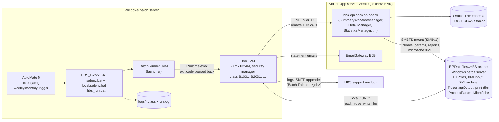
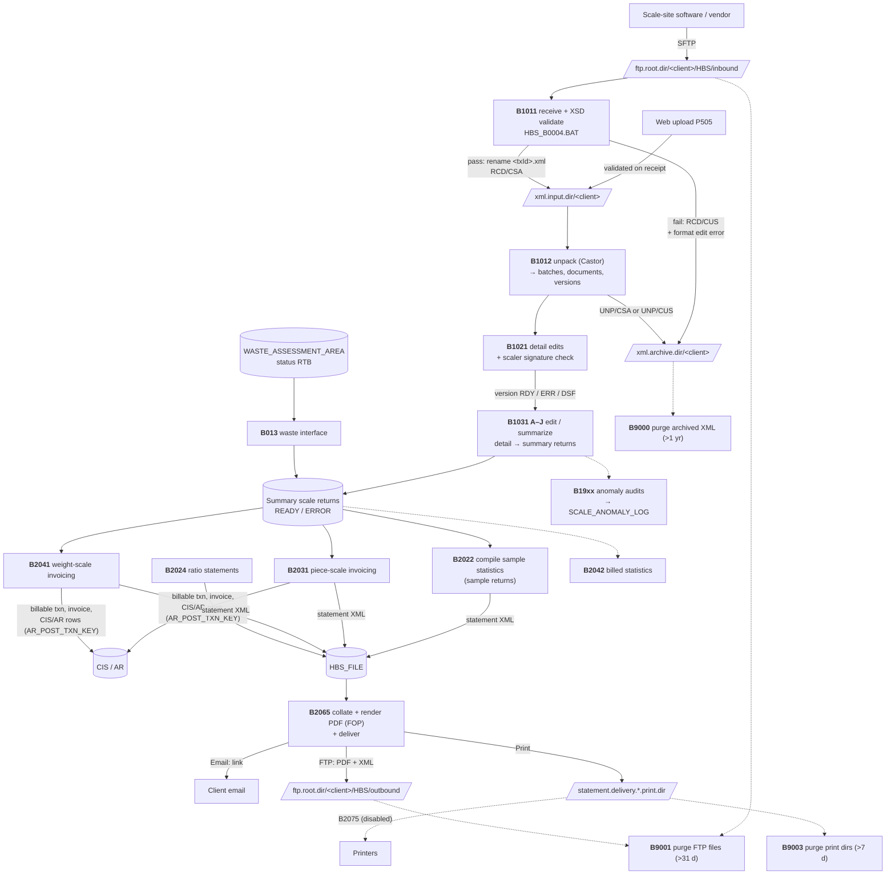

# Legacy batch processing: how it worked

How the legacy HBS batch layer ran, read from `hba-archive/hbs/trunk/source`
(`batch/`, `hbs-batch/`, and the EJBs in `ear/hbs-ejb/`) and the AutoMate
export of active tasks (October 2026). For the port status and the new design,
see [batch-jobs.md](batch-jobs.md).

Paths below are relative to `hba-archive/hbs/trunk/source`. `B/` means
`hbs-batch/src/main/java/ca/bc/gov/mof/hbs/batch/` and `E/` means
`ear/hbs-ejb/src/main/java/ca/bc/gov/mof/hbs/`. Folders are named by their
config key, not their server path.

## 1. Runtime: how a job ran

- **Launch chain.**
  - AutoMate runs `%BATCH_HOME%\hbs\01\bin\HBS_Bxxxx.BAT`. The BAT sources `setenv.bat`, which requires a `local.setenv.bat` holding host-specific values, then calls `hbs_run.bat`. That runs `java BatchRunner <job class> [args]` and appends output to `logs\<class>.run.log`.
  - `BatchRunner` starts the job in a second JVM (`B/util/BatchRunner.java`) using `java.options` (`-Xms1024M -Xmx1024M` plus a security policy) and passes its exit code back to AutoMate.
- **Two instances.** The batch install exists twice (`conf/hbs_batch.01|02.properties`, `jndi.01|02.properties`), each pointing at a WebLogic instance over `t3://`. The active tasks all run instance `01`.
- **The work runs in the server, not the batch JVM.** The job JVM mostly loops over IDs and calls remote EJBs. Business logic, SQL and proc calls live in `hbs-ejb` inside WebLogic.
- **Transactions.** `batch.transactional` is empty, so no job runs inside one `UserTransaction` (`B/util/BatchTransaction.java`). Each EJB call commits on its own. `batch.transaction.timeout` is 3600 s.
- **Failure signal.**
  - log4j `myMail` (`HbsSMTPAppender`, threshold ERROR) emails "Batch Failure - ${batch.name}" to support.
  - Exit codes are unreliable: `AbstractBatch.execute()` catches `BatchException`, logs it and exits 0 (`B/AbstractBatch.java:71-88`). Only unchecked exceptions or explicit `System.exit(1)` make AutoMate see a failure.
- **Where the files are.** The shares are folders on the Windows batch server
  itself, so batch reaches them locally. The Solaris WebLogic tier mounts them
  with SMBFS, which the 2026 Q4 Solaris patch removes. See
  [smbfs-removal.md](smbfs-removal.md).
- **Parameters on a share.** B2031 and B2041 read their start location (DCN) and time limit from the processing-parameter CSV (`PROCESS_PARAMETER_FILE_PATH` / `_NAME`), which Production Control edits on screen P038. Shipped defaults: `B2031,0,180` and `B2041,0,210` (minutes).

## 2. Data flow: from vendor file to invoice

### Status codes along the way

| Object | Codes |
|---|---|
| Transmission (`dtl_scl_doc_transmission`), step/status | RCD/CSA received; RCD/CUS rejected; UNP/PRC unpacking; UNP/CSA unpacked; UNP/CUS unpack failed; HBE/PRC → HBE/CSA edits done |
| Detail document version | ACC (accepted) → RDY / ERR / DSF (signature failed) → LCK (summarized) |
| Output batch (`hbs_output_batch`) | CRT (in progress; reused if a run died) → RTS (done) |
| Statement delivery (`Document_Delivery_Transmission`) | PRC (grouped) → COM (files built) → SUB (sent) |
| XML purge (`hbs_xml_purge_status_code`) | PRG deleted; NOF file not found; NOD directory missing; NOU directory unresolved |

## 3. The jobs

### Intake: files to detail records

| Job | What it does | Reads | Writes |
|---|---|---|---|
| **B1011** receive + validate (`HBS_B0004.BAT`) | Polls every client's inbound folder once per run. Every file is taken, not only `.xml`. Validates against XSD `HBS_Schema_V6_1b.xsd`, namespace `gov.bc.ca/forests/hbs/v3`. | `ftp.root.dir/<client>/HBS/inbound` (folder name = submitter client) | Transmission row. The file is moved to `xml.input.dir`, or to `xml.archive.dir` on failure with a TRANSMISSION_FORMAT_ERROR. |
| **B1012** unpack | Starts by resetting transmissions a crashed run left at UNP/PRC. Unmarshals with Castor into batches (W, P, S, F, A/D), batch documents, and scale documents/versions (production files only; test files get batch rows only). Matches pending paper batches. Stores signature fields **without verifying them**. Rejects non-test web uploads by software-vendor users. | `xml.input.dir` | `dtl_doc_batch*`, detail documents/versions, arrival/departure ledgers, format-error tables. Moves the file to `xml.archive.dir`. |
| **B1021** detail edits | For each accepted version: clears edits, **verifies the scaler signature**, then runs cross-reference and replacement-version edits. | Transmissions at UNP/CSA | Version RDY / ERR / DSF; batch counts |
| `HBS_B0005.BAT` | Runs B1012 then B1021 back to back. | | |
| **B1031** A–J | `-action` E = edit only, S = edit + summarize; `-returnType` P piece, S sample, W weigh slip, F SFP (omitted = all); `-input E` eligible; `-status` RDY/ERR. Summarize re-runs edits, locks the version and extends it into summary scale returns. | RDY/ERR detail versions | Summary scale returns; versions LCK |
| **B013** waste | Turns waste assessment areas into billable piece-scale summary returns. | `WASTE_ASSESSMENT_AREA` status RTB | Summary return (via EJB) + `HBS_STORE_WASTE_ASSESS_AREA` |
| **B1912–B1953** anomaly audits | Gap/duplicate/mismatch checks over a rolling window set in `ANOMALY_ASSESSMENT_CONTROL`. Restart-safe: an AIP run is rolled back first. | Detail data | `SCALE_ANOMALY_LOG`, `HBS_ANOMALY_BATCH_EVENT` |

B1031 variants: A = summarize, all types; B = edit P ERR; C/D = summarize P (D: RDY only); E/F = summarize S (F: RDY only); G = edit W ERR; H/J = summarize W (J: RDY only).

Audit control types: B1912 S scaler-return numbers; B1914 W weigh slips; B1922 A load-arrival numbers; B1932 X arrivals without departures; B1933 D departures without arrivals; B1942 Y weigh slips without samples; B1952 Z weigh slips without red-tag tallies; B1953 R red-tag tallies without weigh slips.

### Billing and statements

| Job | What it does | Notes |
|---|---|---|
| **B2031** piece-scale / **B2041** weight-scale invoicing | Shared `ExtensionBatch`. For each extensible return (READY/ERROR, ordered by DCN, from the start location): `SummaryWorkflowManager.extend()`. That creates the billable transaction, statement XML in `HBS_FILE`, the invoice, and the CIS/AR rows (`forest_invoice`, `*_invoice_dtl`, `AR_POST_TXN_KEY` last). B2031 also calls the waste extend. | Stops when the time limit passes (180 / 210 min). No return caps: `hdbs.max.*` is read but the split logic is commented out. One try per return. A rerun resumes the leftover CRT output batch; the CIS insert skips invoices that already exist. |
| **B2022** sample statistics | `compile()` each extensible sample return into a CRT→RTS batch, then always `updatePopStratumSampleTotals`. | Aborts on the first error ("run B2022 again"). |
| **B2024** ratio statements | For scheduled population profiles and changed sample plans: calculate ratios, create ratio statements, reschedule the profile. | Halts on "Missed Samples for PSY". |
| **B2042** billed statistics | Statistics for populations billed, sampled or plan-changed since the last batch event. `-PY pop/year` limits the run. Records a new batch event when done. | A failed run records no event, so the next run covers the same window. The "By_Pop" AutoMate task points at a `HBS_B2042B.BAT` that doesn't exist. |
| **B2065** collate + transmit | Groups unprocessed `HBS_FILE` statements (proc `HBS_FIND_UNPROCESSED_FILES`) per client/location/recipient (PRC). Builds merged XML and FOP PDF under `reporting.output.directory` (COM). Delivers each by Email (link to `statement.delivery.webapp.url`), FTP (PDF + XML to the client's outbound) or Print (print dirs). No address on file falls back to Print and notifies the help desk. Sets SUB. | State-driven, so restartable. A crash between delivery and SUB re-delivers. |
| **B2075** print | Would send the print dirs to printers named in the printer-parameter file. | Disabled: `main()` is commented out (BT3399). |

### Housekeeping

| Job | Deletes | Rule |
|---|---|---|
| **B9000** | `<txId>.xml` in `xml.archive.dir` | Successful transmissions older than the 1st of the month one year back; sets the purge status on the transmission |
| **B9001** | Everything under `ftp.root.dir` (inbound and outbound) | Modified > 31 days ago |
| **B9002** | `reporting.output.directory` + empty folders | > 31 days |
| **B9003** | Statement print dirs | > 7 days |

## 4. Schedule (AutoMate export, October 2026)

Server local time. Only these 14 tasks were in the export of active tasks; the
repo's `batch/automate/*.aml` files carry no triggers at all.

| Task | Days | Time |
|---|---|---|
| B1031 S summarize eligible (all) | Mon–Fri | 05:25 |
| B2022 sample statistics | Mon–Fri | 07:30 |
| B1031 P summarize eligible RDY | Tue, Thu | 08:00 |
| B1031 W summarize eligible RDY | Mon, Wed, Fri | 08:00 |
| B2042A billed statistics | Mon, Tue, Thu | 09:00 |
| B2031 piece-scale invoicing | Tue, Thu | 15:00 |
| B2041 weight-scale invoicing | Mon, Wed, Fri | 15:00 |
| B1031 P edit ERR | Mon, Wed | 19:00 |
| B1031 W edit ERR | Tue, Thu, Fri | 19:00 |
| B9000 / B9001 / B9002 / B9003 purges | 2nd of the month | 21:00 / 21:05 / 21:10 / 21:15 |
| B013 waste interface | inactive (no trigger) | |

```mermaid
gantt
  title Typical weekday (Tuesday)
  dateFormat HH:mm
  axisFormat %H:%M
  section Summarize
  B1031 S summarize      :05:25, 30m
  B1031 P summarize RDY  :08:00, 30m
  section Statistics
  B2022 sample stats     :07:30, 30m
  B2042A billed stats    :09:00, 30m
  section Invoicing
  B2031 piece-scale (≤180 min) :15:00, 180m
  section Re-edit
  B1031 W edit ERR       :19:00, 30m
```

(Bar lengths are illustrative except B2031's time limit.)

## 5. Gaps and open questions

1. **Intake and delivery aren't in the active export.** B1011, B1012/B1021 (or `HBS_B0005`), B2024, B2065 and the B19xx audits have no active task, yet files are clearly received and statements delivered. Either they run from tasks or triggers outside the export, or a person runs them. Confirm with the AutoMate owner before relying on this schedule ([questions.md](questions.md) Q4).
2. **Signatures are verified in B1021, not on receipt.** B1011 checks schema only. Nothing in the legacy source scans for viruses.
3. **Rejected files give the vendor no file feedback.** B1011/B1012 failures exist only as DB status and edit errors, visible on the online screens. Nothing is written to the client's outbound folder.
4. **Partial-run safety rests on status codes:** reset at UNP/PRC (B1012), reuse of the CRT batch (B2031/B2041/B2022), PRC/COM/SUB (B2065), AIP rollback (audits). There is no checkpoint table. The new jobs should keep these patterns.
5. **Retention differs from the new `XmlArchivePurgeJob`.** Legacy keeps about 1 year and records a purge status; the new job keeps 7 years by file age. See [batch-jobs.md](batch-jobs.md).
6. **Dead or unused code.** The EDI packages (`batch/input/*`: B012, B015, B021) have no BAT or task. The same goes for `output/audit`, the `hdbs.max.*` caps and B2075.
