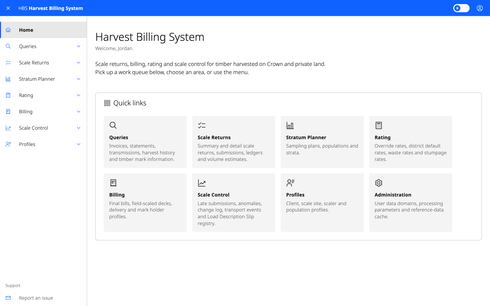
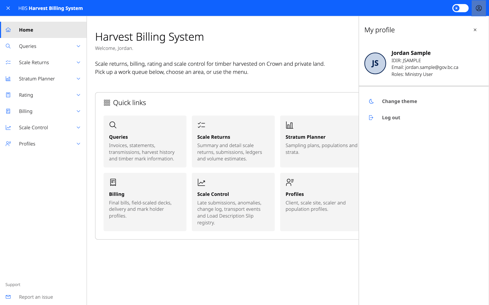
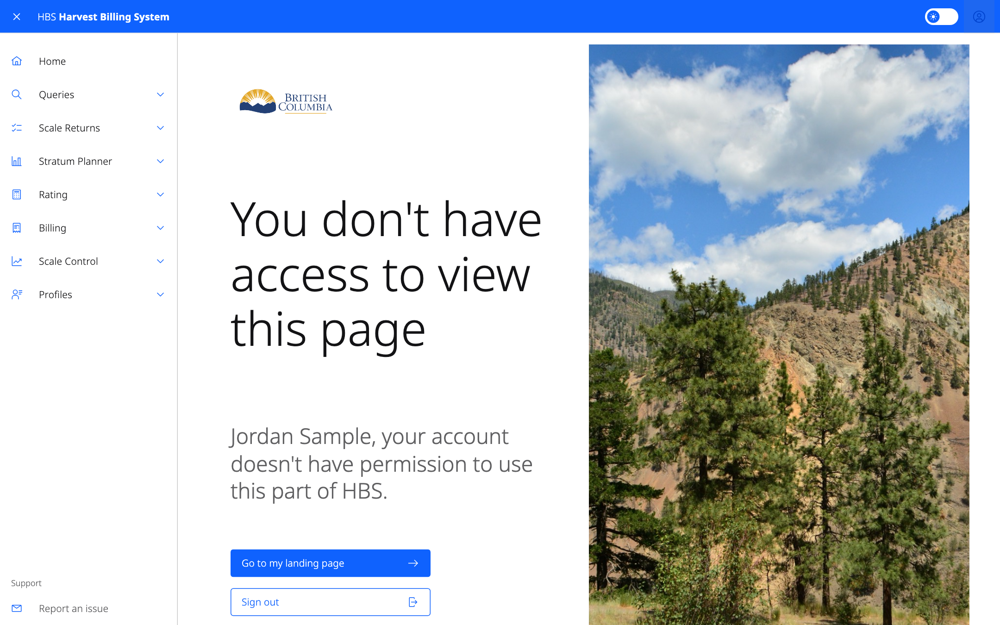
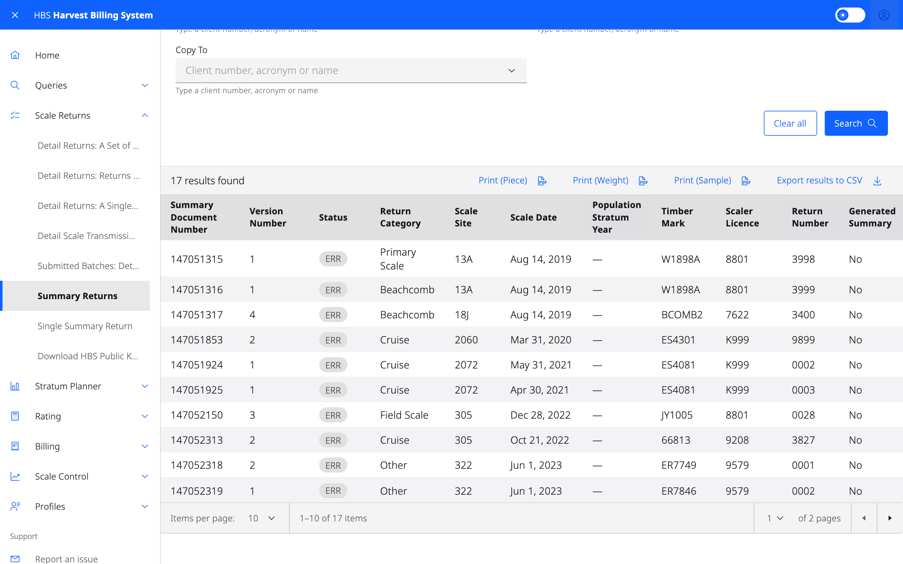

# 1. Getting started

## Logging in

HBS uses BC Government single sign-on.

| You are | Log in with |
|---|---|
| Ministry staff | **IDIR** (with multi-factor authentication) |
| Licensee, scale site, submission agent or software vendor | **Business BCeID** |

Your access comes from the roles granted to you in FAM (Forest Access
Management). If you can log in but HBS says you are not authorized, you have
no HBS role yet. See [How to get access](10-public-area.md#how-to-get-access).

## Choosing an organization (industry users)

If your Business BCeID is registered with more than one forest-client
organization, HBS asks you to **Select organization** after you log in. Your
roles can differ for each organization, and everything you see and do
applies to the organization you chose. To work for a different organization,
log out and log in again.

Ministry users don't choose an organization.

## The home page

The home page welcomes you and shows:

- **Notice** — the current HBS alert message, such as a planned outage.
  It only appears when there is one.
- **Work queues** — links to the summary and detail scale returns that need
  attention, grouped by status (for example *In Progress*, *Awaiting
  Approval*, *In Error*, *Rejected*). Select a link to open the matching list
  of returns. Only shown for roles that have queues to work.
- **Quick links** — one tile for each area you can use.

## Your profile

Select your profile picture in the header to see your user ID, your active organization
(industry users) and the roles you hold. From there you can also **Change
theme** (light or dark) and **Log out**.

## Finding your way around

The left-hand menu groups screens into areas, in the same order as the
legacy tab bar: **Queries**, **Scale Returns**, **Stratum Planner**,
**Rating**, **Billing**, **Scale Control**, **Profiles** and
**Administration**. An area only appears if you can use at least one screen
in it. If you open a link to a screen your roles don't allow, HBS says so
and offers to take you back to your landing page.

Labels in the menu are shorter than the screen titles: for example,
the menu item **Summary Returns** opens **Search for Summary Scale Returns**.

Select the menu icon (top left) to hide or show the menu. **Report an issue**,
at the bottom of the menu, emails the HBS support team.

Many screens are not in the menu. You reach them from a search result, for
example by selecting a document number to open the return.

## Searching

Most screens are searches. They all work the same way:

1. Fill in the **criteria** at the top. Fields marked with `*` are required.
   Some searches ask for "at least one of" a set of fields; the description
   under the title says which.
2. Select **Search**. Results appear in the grey panel below with a count.
3. Select a column heading to sort, where the column allows it. Use the
   pager at the bottom to move between pages or change the page size.
4. Select a highlighted value (such as a document number) to open that
   record.
5. **Clear all** empties the criteria and the results.
6. **Export results to CSV** downloads every result row as a spreadsheet file.

HBS remembers your last search on each screen for the rest of your browser
session, so going back to a search screen shows the same results.

Timber marks, licences and codes are converted to upper case as you type.

## Printing and downloading

Buttons such as **Print**, **Download PDF** or **Download CSV** run a report
from your current criteria or the record you are viewing, and download the
file. Some screens have a single **Print** menu with several reports; some
open a small dialog asking for report options first.

## Making changes

Buttons that change data (for example **Release**, **Hold**, **Approve**,
**Delete**) appear only when your roles allow the action **and** the record
is in a state where it makes sense. If a button you expect is missing, check
the record's status first.

Actions that can't be undone ask you to confirm. Some show a preview of what
will happen, for example which versions and transactions a cancel-and-replace
creates, before you confirm.

On lists you can tick several rows and use a bulk action such as **Hold
Selected**. HBS reports the result for each row: processed, not processed, or
error.

## Session time-out

After **30 minutes** without activity you are logged out. A warning with a
countdown appears **5 minutes** before that. Select **Stay logged in** to
continue. Unsaved changes on a form are lost when you are logged out.

## Logging out

Select your profile picture in the header, then **Log out**. This ends your single
sign-on session for HBS.
