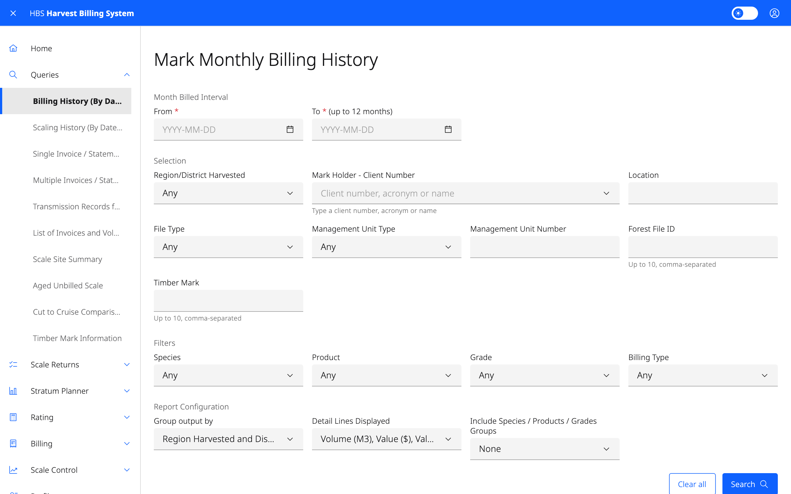
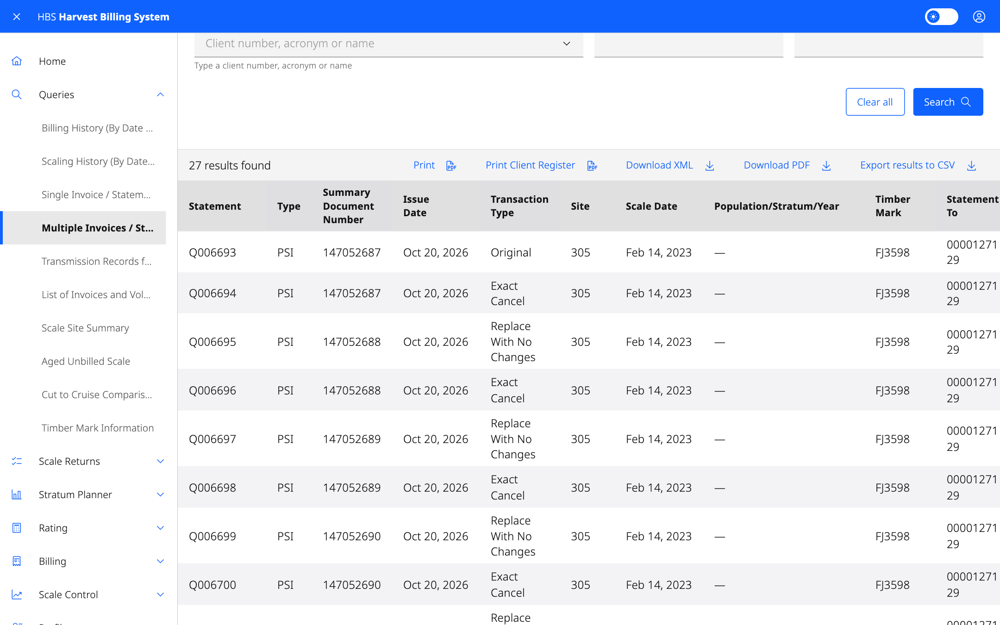

# 2. Queries

Look up invoices, statements, transmissions, harvest history and timber mark
information. Available to ministry and forest-industry users. Industry users
only see documents and history for their own organization.

## Screens

| Menu item | Use it to |
|---|---|
| **Billing History (By Date of Invoice)** | Report billed volumes and values by month for a date range, filtered by district, mark holder, management unit, forest file, timber mark, species, product, grade or billing type. Download as **PDF** or **CSV**. |
| **Scaling History (By Date of Scale)** | The same, for scaled volumes, with region/district scaled and scale site filters. Download as **PDF**. |
| **Single Invoice / Statement** | Open one invoice or statement by its statement number. |
| **Multiple Invoices / Statements** | Find invoices and statements by document type, number, scale or issue dates, timber mark, scale site, population, stratum, district or client (original, copy-to or both). Print the list or a client register. |
| **Transmission Records for Invoices and Statements** | See which statements were transmitted to a client, and when, between two dates. |
| **List of Invoices and Volume Statements** | Run the piece-scale or weight-scale billing summary report. You must give at least one of region/district of harvest, file type, management unit type, forest file ID or timber mark, **and** either region/district of scale or scale site. |
| **Scale Site Summary** | Summarize returns for scale sites or marks, grouped as you choose. |
| **Aged Unbilled Scale** | *Ministry only.* Find scale that has not been billed, by scale method, scaled before a date. |
| **Cut to Cruise Comparison** | Compare cut volumes with cruise volumes. Give a timber mark, forest file ID, client, or client and location. |
| **Timber Mark Information** | Look up a timber mark and open its details. |

## Common tasks

### Get a copy of an invoice or statement

1. **Queries › Single Invoice / Statement**.
2. Enter the **Statement Number** and select **Search**.
3. Use the download button in the result row to save the PDF.

If you don't know the number, use **Multiple Invoices / Statements** with a
timber mark and date range instead. Each result row has **PDF** and **XML**
buttons under **Actions**.

### Check that statements reached a client

1. **Queries › Transmission Records for Invoices and Statements**.
2. Enter the client number, and a location if needed, and the date range.
3. Select **Search**.

Users with the Document Receiver role can also choose **Associated
Locations** to cover every client location in their data domain.
