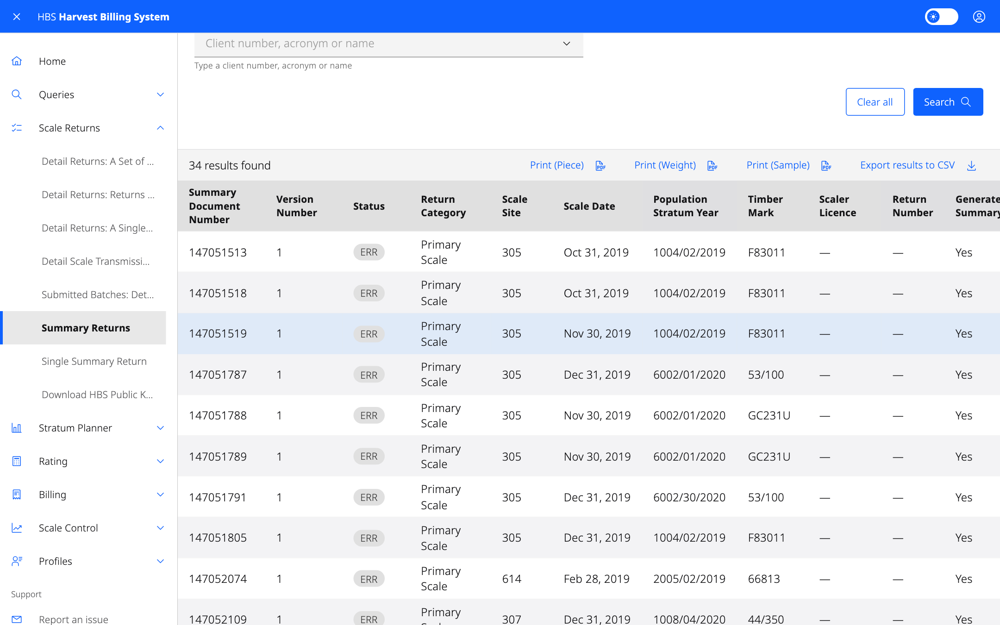
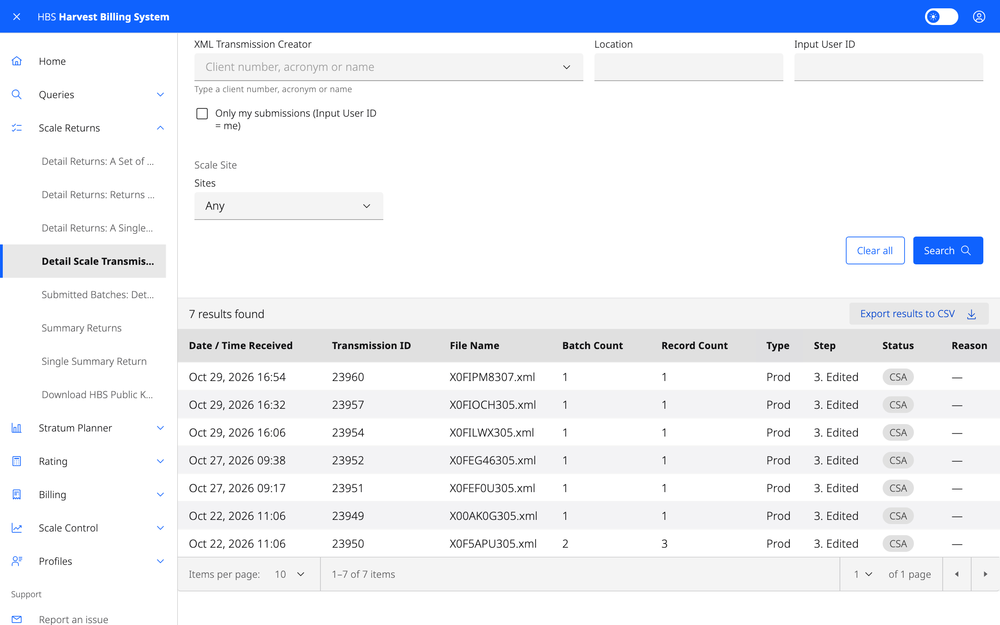
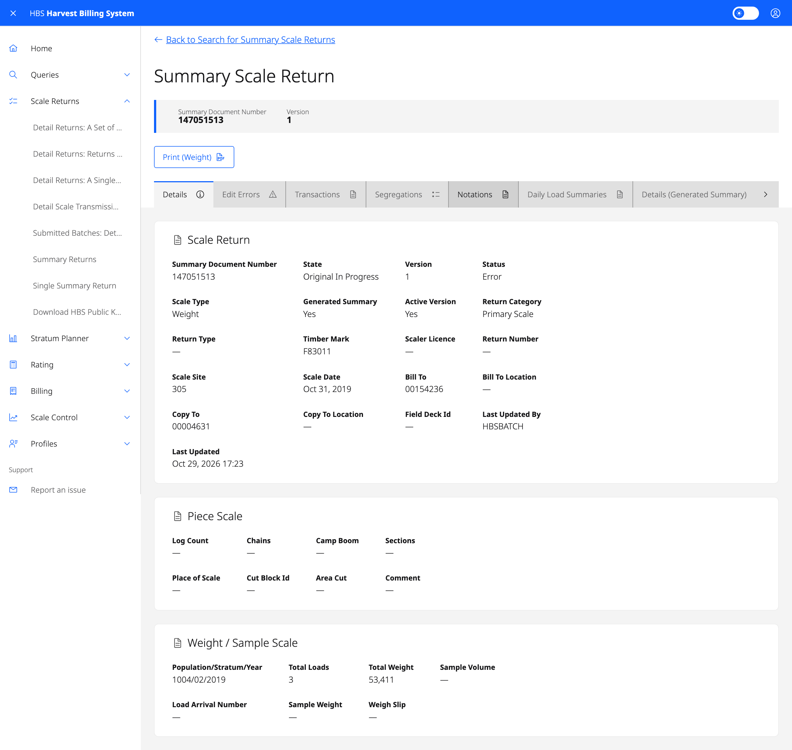

# 3. Scale Returns

Enter, submit, review and correct scale returns. There are two kinds:

- **Summary scale returns** — one return summarizing scale for a mark and
  period: piece scale, weight scale or sample scale. Also used for
  cruise-based (area) billing and volume estimates.
- **Detail scale returns** — individual log tallies, weigh slips, sample
  tallies and arrival/departure ledgers, usually submitted as XML files by
  scale software.

Everyone with an HBS role can view returns for their own data. Entering and
changing returns needs one of the data entry, scaling or correction roles
(see [Who can do what](11-who-can-do-what.md)).

## Screens

### Summary returns

| Menu item | Use it to |
|---|---|
| **Summary Returns** | Find summary returns by scale type, document control number, version status, error code, dates, site, mark, scaler licence, return number or field deck. Select the document control number to open a return. |
| **Single Summary Return** | Open one return by summary document number or statement number. |
| **Add Summary Return: Piece / Estimates** | Enter a new piece-scale return. Also used for cruise-based billing (return type *AREAEST*) and volume estimate returns (cruise, field, waste, other). |
| **Add Summary Return: Weight** | Enter a new weight-scale return. |
| **Add Summary Return: Sample** | Enter a new sample-scale return. |

A new summary return starts as state **Original In Progress**, version 1,
status **Incomplete**.

### Detail returns

| Menu item | Use it to |
|---|---|
| **Detail Returns: A Set of Returns** | Find detail returns by type, version status, event type, error code, dates, site, data domain, population/stratum, mark, cut block or scaler. Print lists or generate PDFs. |
| **Detail Returns: Returns in Submitted Batches** | Find returns by the batch they arrived in. |
| **Detail Returns: A Single Return** | Open one return by detail document number, or by site plus weigh slip, return type, scaler licence and return number. |
| **Detail Scale Transmissions: XML** | See XML files received, their processing step and status. |
| **Submitted Batches: Detail** | See the batches created from each transmission, and download a list of rejected documents. |
| **Submit File of Detail Returns** | Upload an XML file of detail returns. |
| **Download HBS Public Key** | Download the key scale software uses to encrypt submissions. |

## Common tasks

### Submit a file of detail returns

1. **Scale Returns › Submit File of Detail Returns**.
2. Select **Find File** and choose the XML file. It must follow the HBS
   scale data schema (`HBS_Schema_V6_1b`).
3. Submit it.

The file is virus-scanned and checked against the schema before it is
accepted. If it fails validation, the errors are listed on screen and nothing
is loaded. Once accepted, follow its progress in **Detail Scale
Transmissions: XML**. Tick **Only my submissions** to see just yours.

### Work through a summary return

Open the return from **Summary Returns**. The tabs show the return's
**Details**, **Edit Errors**, **Transactions**, **Segregations**,
**Notations** and, for weight scale, **Daily Load Summaries**.

The buttons you see depend on your roles and the return's state:

| Button | What it does |
|---|---|
| **Update** (edit) | Change an in-progress return. Generated summaries can never be edited. |
| **Release** | Release the return for billing. |
| **Hold** | Stop the return from being billed until it is released. |
| **Discard** | Throw away an in-progress version. |
| **Cancel** | Cancel an invoiced return. |
| **Cancel & Replace With / Without Changes** | Cancel an invoiced return and create a replacement version, edited or as-is. |
| **Replace With / Without Changes** | Replace a return that has been cancelled and invoiced. |
| **Request Rate Correction** | Ask for a rate correction on an invoiced generated summary. |
| **Approve / Reject Rate Correction** | Decide on a requested rate correction. |

Before a cancel or replace, HBS shows a preview of the versions and
transactions it will create. Confirm to go ahead.

### Work through a detail return

Open the return from any detail search. Depending on your roles and its
state you can **Release**, **Re-Edit**, **Hold**, **Cancel**, **Cancel and
Replace with Changes**, **Replace with / without Changes**, **Discard** or
**Clear Digital Signature Failure**. Changes that need sign-off show
**Approve Change** and **Reject Change** to approvers. Use the **Print**
buttons for a log tally, weigh slip, sample tally, special forest product
tally or ledger entry.

### Batch slips (ministry)

Batch slips track paper returns sent to headquarters. From a batch slip
search you can **Generate a Batch Slip**, update one, and **Confirm** or
**Cancel** it.
