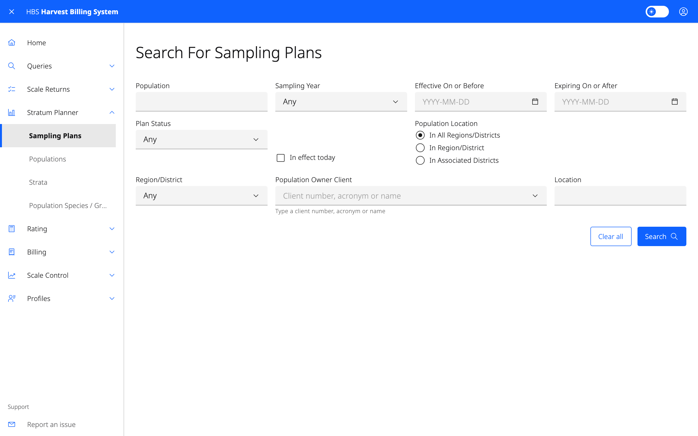

# 4. Stratum Planner

Manage weight-scale sampling: sampling plans, populations, strata and the
default species/grade ratios used to convert weight to volume. Available to
ministry and forest-industry users. Changes need the Sample Plan
Administrator role (ministry, or industry for your own populations).

## Screens

| Menu item | Use it to |
|---|---|
| **Sampling Plans** | Find plans by population, sampling year, dates, status, location, district or owner. |
| **Add Sampling Plan** | Create a new plan. You can also create the population if it doesn't exist yet. |
| **Populations** | Find populations by population, year or owner. |
| **Strata** | List the strata in a population and year. |
| **Population Species / Grades** | Statistics for a population. Drill down to a stratum and to a single sample. |

## Common tasks

### Take a sampling plan through approval

1. Open the plan from **Sampling Plans**.
2. Add strata with **Add Stratum**. Open a stratum to edit it, set its
   **Estimates**, and add default ratios with **Add Default Ratio**.
3. Select **Propose** when the plan is ready.
4. An administrator selects **Approve** or **Reject**.

Other plan actions:
- **Copy** starts a new plan from this one.
- **Create New Plan From Actuals** starts one from the samples actually taken.
- **Delete** removes the plan.

Use **Print Sample Plan Report** or **Print Stratum Description Report** for
paper copies.
