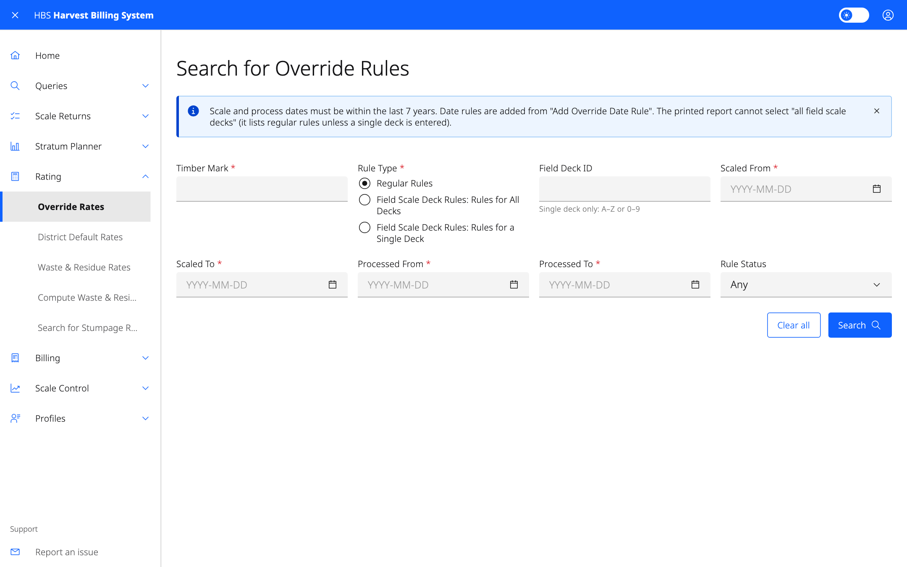

# 5. Rating

Look up and maintain the rates HBS bills with. Override rules and district
default rates are ministry-only. Waste and residue rates and stumpage rates
are also visible to forest-industry users.

## Screens

| Menu item | Who | Use it to |
|---|---|---|
| **Override Rates** | Ministry | Find override rules by timber mark, rule type, field deck, scale or processed dates, or status. |
| **District Default Rates** | Ministry | Find default rates by district, appraisal method and effective dates. |
| **Waste & Residue Rates** | All | Find waste/residue rates by timber mark, cut block and scale dates. |
| **Compute Waste & Residue Average Rate** | All | Compute an average rate for a mark over a period, by species and grade. |
| **Search for Stumpage Rate** | All | Look up the stumpage rate that applies. |

## Common tasks

### Add an override rate rule

1. **Rating › Override Rates**, then add a rate rule. The
   screen is **Add Override Rate Rule**.
2. Enter the timber mark (or field scale deck ID), the scale and/or process
   date ranges it applies to, and a reason.
3. Save, then add rate lines (species, product, grade, rate) with **Save and
   Add More Rate Details**.
4. Select **Activate Rule** when it is complete. A rule can later be
   switched off with **De-activate Rule**.

To bill a mark (or field deck) at the rates of a different date instead,
add an **Override Date Rule** from the same screen.

### Update a district default rate

*Rate Administrator role.*

1. **Rating › District Default Rates** and search.
2. Select a rate in the results to open **Update Default Rate**, change it
   and save.

Without the Rate Administrator role the results are read-only: the rows
are not links.

Changing rates needs the Rate Administrator role. Changing waste and residue
rates needs the Waste/Residue Rate Administrator role.
