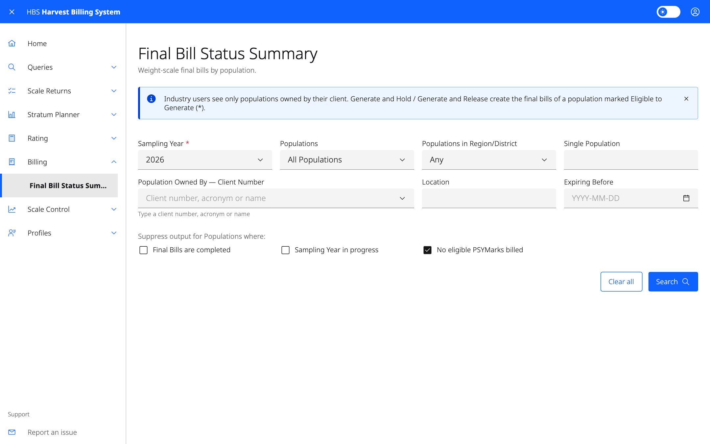

# 6. Billing

Final bills for weight-scale populations, the tenures that receive them,
field-scaled decks, and forcing summarization dates. Status screens are
visible to ministry and forest-industry users. Everything else needs a
billing role.

## Screens

| Menu item | Who | Use it to |
|---|---|---|
| **Final Bill Status Summary** | All | See final-bill progress by population and sampling year. Drill into one population for its strata. |
| **Search For Unissued Final Bills** | Billing Administrator, Super Manager | List final bills that are Ready, Held or in Error. Tick rows and use **Hold Selected** or **Release Selected**. |
| **Non-Renewable Tenures That Receive Final Bills** | Billing Administrator, Super Manager | Maintain the list of tenures that get final bills (add, update, delete). |
| **Non-Renewable Tenures Not Receiving Final Bills** | Billing Administrator, Super Manager | See tenures whose ratios are frozen and get no final bill. |
| **Field Scaled Decks** | Billing Administrator, Scaling Administrator, Super Manager | Find returns by timber mark or field scale deck ID and open the field scale overview. |
| **Force Piece Scale Tally Summarization** | Super Manager | Force the next piece-scale summarization date on mark holder profiles. |
| **Force Weigh Slip Summarization** | Super Manager | Force the next weight-slip summarization date on mark holder profiles. |
| **Force Ratio Computation** | Super Manager | Force the next ratio computation date on population profiles. |

## Common tasks

### Hold or release final bills before they issue

1. **Billing › Search For Unissued Final Bills**.
2. Filter by mark, population, sampling year, stratum or status, and select
   **Search**.
3. Tick the bills, then select **Hold Selected** or **Release Selected**.
   The result is shown for each bill.

### Force a summarization

1. **Billing › Force Piece Scale Tally Summarization** (or **Force Weigh Slip
   Summarization**).
2. Narrow the profiles by frequency, client and location, and give the
   **Force date**.
3. Search to see the profiles affected, then apply it to the listed profiles
   or to all matching profiles.
