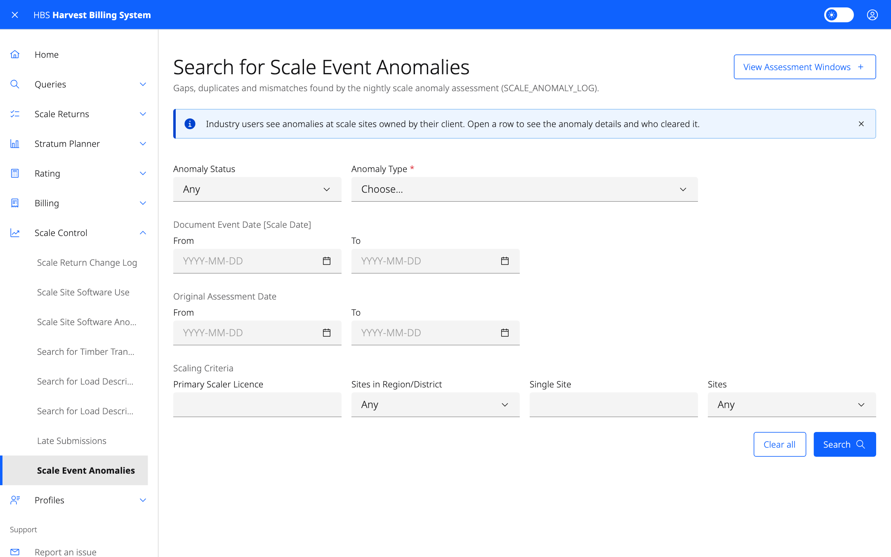

# 7. Scale Control

Monitor scaling for problems: late submissions, anomalies found overnight,
changes made to returns, timber transport, Load Description Slip (LDS)
registry use, and the software sites submit with.

## Screens

| Menu item | Who | Use it to |
|---|---|---|
| **Late Submissions** | All | Find detail returns received more than a given number of days after their scale date. |
| **Scale Event Anomalies** | All | Find gaps, duplicates and mismatches found by the nightly anomaly check. Print a report for each anomaly type. |
| **Scale Site Software Anomalies** | All | Find returns submitted with software that is not on file, or not valid on the scale date. |
| **Scale Site Software Use** | All, plus software vendors | See which software product, version and revision each scale site submitted with. |
| **Scale Return Change Log** | Ministry | Find field-level changes made to returns, by format, date range and user. |
| **Search for Timber Transport Events** | Ministry | Find departures, arrivals and intra-site movements by mark, cut block, site, dates, load or weigh slip number. |
| **Search for Load Description Slip Registry Entries** | Ministry | Find the LDS number ranges registered to a mark and cut block. |
| **Search for Load Description Slip Registry Violations** | Ministry | Find loads that used LDS numbers outside the registered ranges. |

## Common tasks

### Clear a scale anomaly

1. **Scale Control › Scale Event Anomalies**.
2. Filter by status, type, dates, scaler or site, and select **Search**.
3. Open the anomaly and select **Clear** once it is explained.

Clearing anomalies needs the Scaling Administrator role.

### Register LDS numbers for a cut block

1. **Scale Control › Search for Load Description Slip Registry Entries**.
2. Add an entry with the timber mark, cut block, and starting and ending
   numbers.

Entries can be updated or deleted later from their detail page. This needs
the Scaling Administrator role.

### See the change history of one return

From a return, open its change log. The **Scale Return Change Log** shows
every changed field for that document and version.
