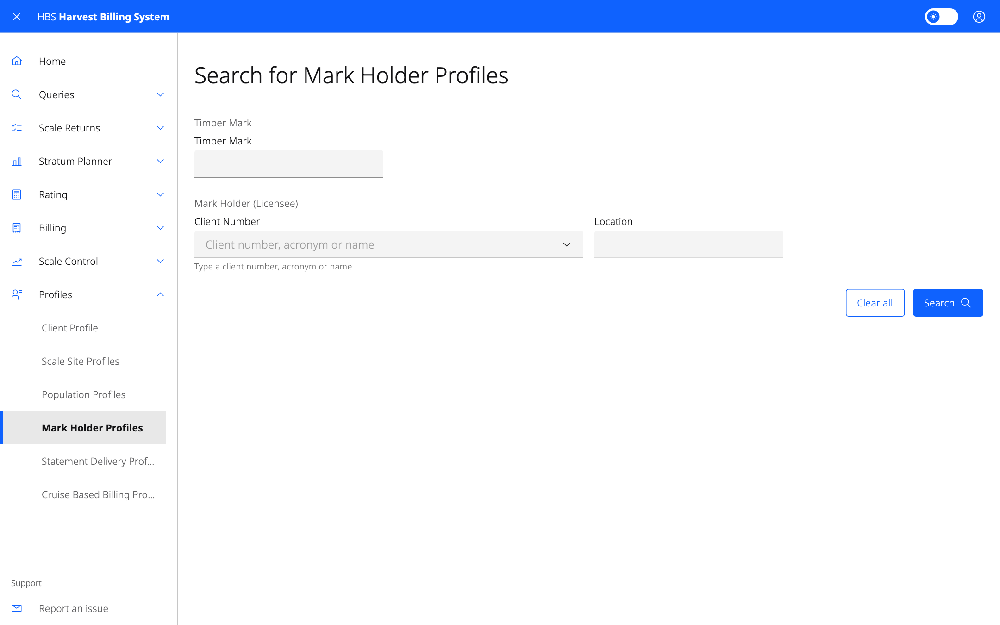

# 8. Profiles

Profiles hold the settings HBS uses for each client, site, population, mark,
scaler and statement delivery. Anyone with an HBS role can view profiles for
their data. Changes need the role shown below.

## Screens

| Menu item | Change role | Holds |
|---|---|---|
| **Client Profile** | — (view only) | Client details by client number and location |
| **Scale Site Profiles** | Scaling Administrator | Submission type, return type and effective dates for each scale site |
| **Population Profiles** | Sample Plan Administrator | Sampling year, frequency and ratio computation period for each population |
| **Mark Holder Profiles** | Billing Administrator | Return type, summarization frequency and next scheduled summarization for each timber mark |
| **Statement Delivery Profiles** | Billing Administrator | How statements are delivered to a client location |
| **Cruise Based Billing Profiles** | Billing Administrator | m³/ha by species and billing code for cruise-based marks |
| **Scaler Profile** | Scaling Administrator, Industry Scaler | A scaler's authentication keys |
| **Scalers with Expiring Authentication Keys** | Scaling Administrator | Scalers whose authentication keys expire before a date |
| **Request Authentication Key** | Scaling Administrator, Industry Scaler | Issue a new authentication key for a scaler |

Each profile search leads to a detail page with **Update** and **Delete**,
and an **Add** form, for users with the change role.

## Common tasks

### Issue a scaler authentication key

1. **Profiles › Request Authentication Key**.
2. Enter the scaler licence, the requested key (7 to 9 upper-case letters or
   digits; HBS adds a check digit), and the scale date it is active from.
3. Save. The confirmation shows the full key and its active dates.

**Record the key and give it to the scaler straight away. It is not shown
again.**

### Change how a client receives statements

1. **Profiles › Statement Delivery Profiles**, search by client
   number and location.
2. Open the profile and select **Update**, or add a new profile with a new
   effective date.
3. Choose the **Document Delivery Method** and save.
