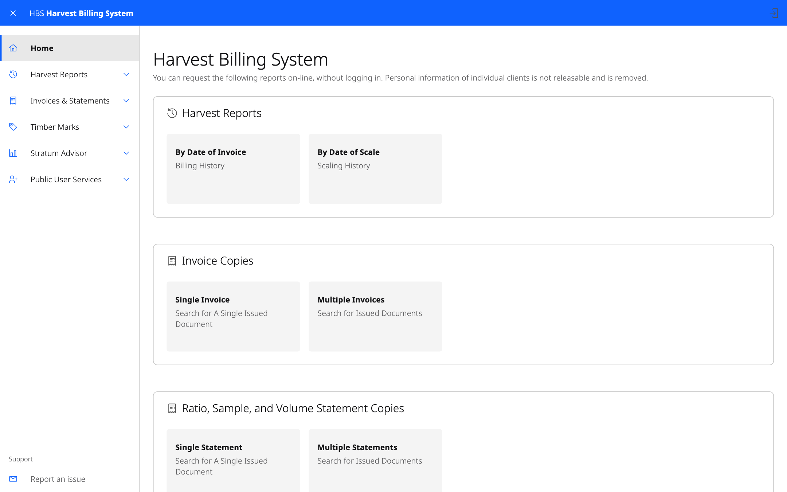

# 10. Public area

Some HBS information is public. Anyone can open the public area without
logging in. It is read-only, and names and addresses of individual clients
are shown as "Not Releasable".

## What is there

| Menu | Contents |
|---|---|
| **Harvest Reports** | Public harvest and billing reports |
| **Invoices & Statements** | Copies of issued invoices and statements, and **Invoice Information** |
| **Timber Marks** | Timber mark information |
| **Stratum Advisor** | Which stratum a load belongs to |
| **Public User Services** | **How to get access** |

Searches in the public area return a limited number of rows. If you send a
lot of requests in a short time you are asked to wait before trying again.

## How to get access

**Public User Services › How to get access** explains how to request an HBS
role through FAM. Once you hold a role, log in with IDIR or Business BCeID
(see [Getting started](01-getting-started.md)).
