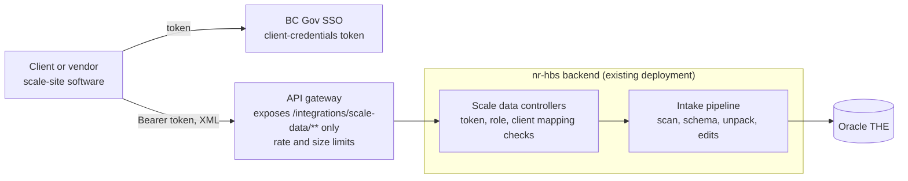

# Scale data API: where it runs

**Status: decision, 2026-11-12. Built in nr-hbs except change 11 (below).** Records where the scale data
API ([scale-data-api.md](scale-data-api.md)) runs and what nr-hbs has to change
to host it. The API contract in the spec and the
[client guide](scale-data-api-client-guide.md) is unchanged; this doc covers
hosting, the gateway and security only.

## Decision

**The scale data API is built in the nr-hbs backend, behind an API gateway that
exposes only the client endpoints.** No separate service. The
`nr-hbs-client-api` repo (created from quickstart-openshift for this purpose)
is not used and can be archived; someone on the team does that, since it is a
repository setting.

## Options considered

| Option | What it is | Why not chosen |
|---|---|---|
| **A. In nr-hbs, behind a gateway** (chosen) | Controllers in nr-hbs over the existing intake code; the gateway decides what is public. | — |
| B. Separate gateway service (`nr-hbs-client-api`, Spring Boot 4 native image) | New repo owns client auth, client mapping, duplicates, limits and the error contract, and calls new internal nr-hbs endpoints. | It adds an internal API that has to be versioned, secured and deployed together with nr-hbs and would mostly repeat the client contract. The API gateway already gives the "expose only some endpoints" separation. |
| C. Separate service straight to Oracle | New repo copies the validator, unpack and transmission-proc code and reads `THE` directly. | Business logic in two repos that must stay identical (web upload P505 and the API must accept and bill files the same way). Writes go through 24-argument `HBS_*` procs nr-hbs already wraps. Jasper statement PDFs don't work well in a native image, so statements would still come from nr-hbs. |
| D. Hybrid (reads from Oracle, writes through nr-hbs) | Mix of B and C. | Both repos couple to the `THE` schema, plus the internal API. |

### Why A

- **The pipeline is already in nr-hbs.** Virus scan (`VirusScanner`), schema
  check (`ScaleDataXmlValidator`), transmission procs (`SubmissionService`),
  unpack (`intake/`), statements (`StatementTransmissionController`,
  `StatementDocumentService`), and later the B1021 edits. Every endpoint in
  the spec is a thin controller over that code.
- **One code path for web and API.** P505 and the API run the same intake and
  the same duplicate check.
- **Transactions and locking stay together.** Per-document locks, the sweep
  job that finishes interrupted transmissions, and the re-edit trigger all sit
  next to the unpack and edit code, not across a network hop.
- **Service-account auth mostly exists.** `AuthorizedPartyValidator` already
  accepts service-account tokens whose roles are all service roles, and
  `LegacyBridgeAccess` already confines such tokens to their own paths.
- **Volumes are low** (rate limit proposed at 60 requests a minute per
  account), so separate scaling, fast startup and a native image aren't needed.

### What option A gives up

- **No native image.** nr-hbs carries Jasper and Oracle JDBC. That doesn't
  matter at these volumes.
- **Releases with nr-hbs.** The API ships when the backend ships.
- **Shared pods with staff traffic.** If machine traffic ever affects staff
  users, deploy the same backend image a second time with a profile that
  enables only the integration endpoints, with its own HPA. The gateway then
  targets that deployment. Not needed now.

## Split of responsibilities

The gateway is the first gate, not the only one. nr-hbs must refuse a call
that should not get through even if the gateway is misconfigured or bypassed
from inside the cluster.

| Concern | API gateway | nr-hbs |
|---|---|---|
| Which paths are public | Only `/api/v1/hbs/integrations/scale-data/**` (and the client OpenAPI doc) | All paths exist; the service role is confined to the scale-data paths |
| Authentication | May check the token; **must pass `Authorization` through unchanged** | Validates the token: signature, issuer, expiry, `azp` on the allow-list, `HBS_SUBMISSION_API` role |
| Which clients an account may submit for | — | Account-to-client mapping (`403 CLIENT_NOT_PERMITTED`) |
| Rate limit (proposed 60/min per account) | Yes: `429` + `Retry-After` | No |
| Size limit (proposed 10 MB) | Yes: reject early | Yes: backstop (`413 FILE_TOO_LARGE`) |
| Timeout | Upstream timeout ≥ 300 s | Route timeout already 300 s |
| Request id | Forward the client's or generate one | Use it, log it, return it as `correlationId` |
| Duplicates, idempotency, processing, errors | — | Everything in [scale-data-api.md](scale-data-api.md) |

## Changes in nr-hbs

### Security

1. **New service role.** Add `HBS_SUBMISSION_API` to `HbsRoles` and to
   `HbsRoles.SERVICE`.
2. **Generalize the service-account confinement.** `LegacyBridgeAccess.isPerson`
   only refuses tokens carrying `ROLE_HBS_LEGACY_BRIDGE`. Change it to refuse
   **any** role in `HbsRoles.SERVICE`; otherwise a submission token counts as
   a person and reaches every staff endpoint (capabilities would still block
   most, but not by design). Then add the scale-data paths to the filter chain
   (`/api/v1/hbs/integrations/scale-data/**` → `hasRole('HBS_SUBMISSION_API')`),
   next to the legacy bridge's. Consider renaming the class to
   `ServiceAccountAccess`.
3. **Client-id allow-list.** `hbs.keycloak.legacy-bridge-client-id`
   (`KEYCLOAK_LEGACY_BRIDGE_CLIENT_ID`) already takes a comma-separated list.
   Add a separate `hbs.keycloak.submission-client-ids` property rather than
   mixing client accounts into the bridge's setting, and pass both to
   `AuthorizedPartyValidator`. A per-role allow-list (bridge ids may only carry
   the bridge role, submission ids only the submission role) is stricter.
4. **Account-to-client mapping.** Resolve the token's `azp` to the client
   numbers it may submit for; enforce on every endpoint, including reads.
   Where it lives is still open question 2 in the spec.
5. **Audit user.** `API\<account name>`, truncated to 30 characters, instead of
   `RequestUtil.getCurrentAuditUserId()` for service tokens.

### Endpoints

6. **Controllers** for the seven endpoints in the spec, under
   `/api/v1/hbs/integrations/scale-data`. `POST /submissions` reuses
   `SubmissionService` (split out a method that takes bytes, a file name, a
   client number and the audit user, so P505 and the API share it) and then
   runs the unpack in the request instead of waiting for `UnpackJob`.
7. **Size limit for this path.** `spring.servlet.multipart.max-file-size` is
   100 MB and applies to the whole app (report uploads need it). Enforce the
   10 MB limit for scale-data requests in a filter or the controller (checking
   `Content-Length`, then counting bytes read), and return `413`.
8. **Error body.** A `@RestControllerAdvice` scoped to the scale-data
   controllers that returns `{ code, message, errors[], correlationId }` as
   specified, so it doesn't change the error shape staff screens get.

### OpenAPI

9. **Client-only document.** springdoc's `/v3/api-docs` lists every staff
   endpoint. Add a `GroupedOpenApi` (for example group `scale-data`,
   `pathsToMatch("/api/v1/hbs/integrations/scale-data/**")`), with the bearer
   scheme and the client guide's descriptions. The gateway exposes only
   `/v3/api-docs/scale-data`; the full document stays internal.

### Correlation id

10. `RequestResponseInterceptor` echoes a `correlationID` request header but
    never creates one. For scale-data requests: take the gateway's header (agree
    on its name; the client guide calls the body field `correlationId`),
    generate a UUID if missing, put it in the logging MDC, return it as a
    response header and in every error body.

### Exposure and deployment

11. **What the gateway points at.** The backend has no route of its own; it is
    reached through the frontend's Caddy route (`frontend/openshift.route.yml`,
    timeout 300 s), which proxies `/api*` through the Coraza WAF. Either:
    - the gateway targets the existing frontend route (no new OpenShift
      objects; requests also pass the WAF, whose body-size and XML rules must
      allow scale files), or
    - add a backend Service/Route (or a route only the gateway can reach) with
      `haproxy.router.openshift.io/timeout: 300s`.

    Decide with the gateway owners.
12. **Config.** Add the new properties to `application.properties`,
    `backend/openshift.deploy.yml` and the deploy workflows.

### Docs

13. Update [scale-data-api.md](scale-data-api.md): the gateway in the diagram
    and the auth section, the split of responsibilities above, and the
    generalized service-account confinement.
14. Update [scale-data-api-client-guide.md](scale-data-api-client-guide.md): the
    API base URL is the gateway's, and any gateway onboarding step (for
    example a gateway consumer or key, if it requires one in addition to the
    SSO token).
15. Add this doc to [README.md](README.md), and the new role to
    [roles-and-security.md](roles-and-security.md).

## Status (2026-11-12)

| Change | State |
|---|---|
| 1–3 Security: `HBS_SUBMISSION_API`, any service role refused on staff paths, per-role allow-list | Done. Instead of a `submission-client-ids` property, the scale-data chain has **its own JWT decoder** that accepts only client ids in the account mapping; the staff decoder never accepts them. |
| 4 Account-to-client mapping | Done: `SCALE_DATA_API_ACCOUNTS` in the settings ConfigMap. |
| 5 Audit user `API\<account>` | Done. |
| 6 Controllers | Done; `POST /submissions` shares `SubmissionService.receive` with P505 and unpacks in the request. |
| 7 Size limit | Done: `Content-Length` checked before authentication, bytes counted in the controller (`413`). |
| 8 Error body | Done, scoped to the scale-data controllers. |
| 9 Client-only OpenAPI document | Done: `/v3/api-docs/scale-data` (staff document: `/v3/api-docs/hbs`). |
| 10 Correlation id | Done: the `hbs.scale-data-api.request-id-header` (default `X-Request-ID`) or `X-Correlation-ID`, else a UUID; MDC `correlationId`, response header, every error body. |
| 11 Exposure | Done: **the gateway is registered against the backend Service's in-cluster URL** (`http://nr-hbs-backend-<zone>.<namespace>.svc:8080`, decided 2026-11-12), so there is no Route, public host or IP allowlist, and the frontend's Caddy and WAF are unchanged. `backend/openshift.scale-data-gateway.yml` adds a NetworkPolicy admitting the APS Kong data plane (Gold namespace `b8840c`, per APS "Set Up an Upstream Service") to the backend pods on 8080. `reusable-deploy.yml` applies it in TEST and PROD only, when the environment variable `SCALE_DATA_GATEWAY_ENABLED` is `true`. The gateway configuration is in [`.gwa/`](../.gwa/README.md) (2026-11-13): it exposes only the scale-data paths and `/v3/api-docs/scale-data`; the backend refuses submission tokens everywhere else regardless. |
| 12 Config | Done: `HBS_SCALE_DATA_API_ENABLED`, `SCALE_DATA_API_PUBLIC_BASE_URL`, `SCALE_DATA_API_ACCEPT_ROLE_SCOPES` in `backend/openshift.deploy.yml` and `reusable-deploy.yml`. |

## Open questions

These add to the open questions in [scale-data-api.md](scale-data-api.md).

| # | Question | Who decides | Blocks |
|---|---|---|---|
| 1 | Which gateway (for example the BC Gov API Gateway), who owns its configuration, and whether it does its own authentication in addition to passing the SSO token | Team + gateway owners | **Decided: the BC Gov API Gateway (APS, Kong), configured by the team from `.gwa/`.** It checks the SSO token's signature, issuer and expiry (`jwt-keycloak`) and passes `Authorization` through; roles and scopes are checked by the backend. A request the gateway refuses gets Kong's body, not the API's error contract. |
| 2 | What the gateway targets: the frontend's Caddy route or a new backend route (change 11) | Team + gateway owners | **Decided: the backend Service, in-cluster**, admitted from APS's Gold namespace `b8840c` |
| 3 | Where rate limiting sits if the gateway can't key it per SSO account (per client id) | Team | **Decided: both.** The gateway limits per IP (it has no consumer per account); the backend limits per account. |
| 4 | Name of the request-id header the gateway forwards | Team + gateway owners | **Decided: `X-Request-ID`** (Kong `correlation-id` plugin; a client's own value is kept). |
