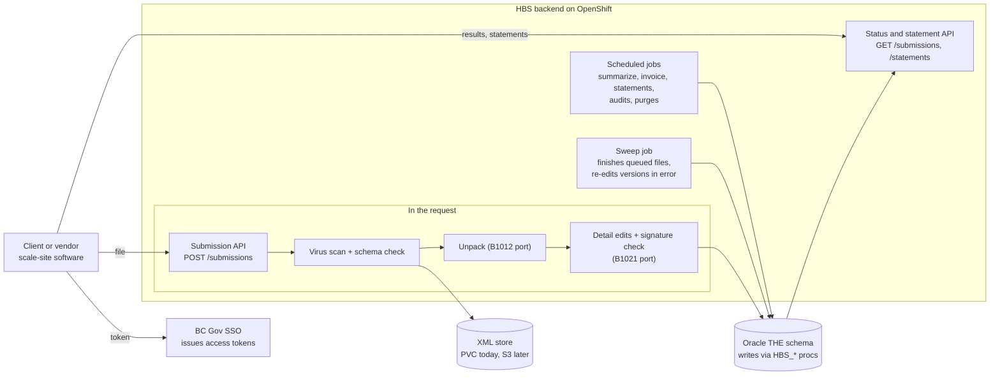
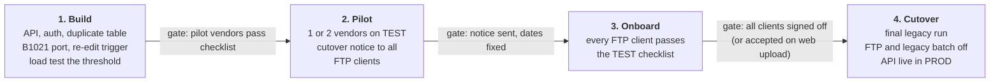

# Scale data API: FTP → REST migration spec

**Status: draft proposal, not built, not signed off.** Replaces the FTP
channel scale-software vendors and clients use today (pinch point 5,
[questions.md](questions.md) Q3). **Assumes the legacy batch is retired when
the API goes live:** intake, detail edits and everything after them run in
this app, and there is no period where FTP and the API run side by side. The
client-facing version is
[scale-data-api-client-guide.md](scale-data-api-client-guide.md); keep the two
in step when the interface changes.

## Recommendation

**A REST API is the right replacement for FTP, and with the legacy batch gone
it can process each file while the client waits.** S3 is a good backend store,
but it is an internal choice: clients never talk to S3 directly.

Why REST beats a managed SFTP service:

- **The answer comes back in the response.** FTP files waited for the next
  batch run to be validated, unpacked and edited. The API does all of that in
  the request, so the client gets each document's result (ready, edit errors,
  signature failed) in seconds.
- **Real credentials.** OAuth client-credentials tokens from BC Gov SSO replace
  shared FTP passwords and per-client `<CLIENT>$` share ACLs, which OpenShift
  can't mount anyway.
- **One intake path.** API files and web uploads (P505) go through the same
  service; the `FTPfiles` share, B1011 and the B9001 purge go away.
- **Status without a person.** Clients read results from the API instead of
  phoning the help desk or reading screen P032.

Where S3 fits, and where it doesn't:

- **Yes, as the store behind the API.** Today the XML sits on a ReadWriteMany
  PVC (`/data/hbs/xml`). Moving to S3-compatible object storage (OCIO Object
  Storage or NRS ECS) removes the PVC quota limit and gives versioning and
  object lock for retention ([questions.md](questions.md) Q7). Only
  `SubmissionStorage` changes.
- **No, as the client interface.** Pre-signed S3 upload URLs would let files in
  before they are scanned and validated, and the files are small XML. Every
  file goes through the API.
- **Not on the critical path.** The API can ship on the PVC and move to S3
  later without clients noticing.

## How FTP works today

Clients and their scale-software vendors use FTP in two directions: they drop
scale-return XML in, and they pick statements up. Both run through the legacy
Windows batch server and the `FTPfiles` share
([legacy-batch.md](legacy-batch.md)).

| Direction | What the client does | What HBS does | Feedback to the client |
|---|---|---|---|
| Inbound (scale returns) | Put an XML file into `FTPfiles\<client>\HBS\inbound`, through the file-transfer service or a mapped `<CLIENT_NUMBER>$` share (protocol unconfirmed; open question 12). The folder name identifies the submitting client. | B1011 polls every inbound folder, validates against `HBS_Schema_V6_1b.xsd` (namespace `gov.bc.ca/forests/hbs/v3`), creates the transmission row and moves the file to `XMLinput`. B1012 unpacks, B1021 runs detail edits and checks the scaler signature. B1031 re-edits versions in error on a schedule. | None directly. Results show up on screen P032 (transmission search) after the batch runs. |
| Outbound (statements) | Pick up PDF + XML from `FTPfiles\<client>\HBS\outbound`. | B2065 groups unprocessed statements per client and recipient and, for clients whose delivery method is FTP, writes the PDF and XML (`HBS_Transmission_Schema_V1_0h`) to the outbound folder. | The file appears, or it doesn't. |
| Housekeeping | — | B9001 deletes everything under `FTPfiles` older than 31 days. | Files a client didn't collect are gone. |

Transmission status codes (from `dtl_scl_doc_transmission`): RCD/CSA received,
RCD/CUS rejected, UNP/PRC unpacking, UNP/CSA unpacked, UNP/CUS unpack failed,
HBE/PRC and HBE/CSA detail edits running and done. Each document version then
ends as RDY (ready), ERR (edit errors) or DSF (signature failed). These codes
stay in the database after legacy retires; the API maps them to plain names.

The web upload (P505) and the unpack (B1012, `intake.UnpackJob`) are already
ported to this app. The detail edits (B1021) and the re-edit runs (B1031) are
not yet ([batch-jobs.md](batch-jobs.md)); this spec depends on their port.

## What runs during the request, and what stays scheduled

Everything that concerns one file runs in the request. Only work that spans
billing periods or many clients stays scheduled.

| Work | Legacy job | After legacy |
|---|---|---|
| Virus scan, schema check, transmission row | B1011 | in the request (already, for P505) |
| Unpack into batches, documents, versions | B1012 | in the request |
| Detail edits, signature check, replacement versions | B1021 | in the request |
| Re-edit versions in error when related data arrives | B1031 edit-ERR runs | triggered by the new data, plus a scheduled sweep |
| Summarize to summary returns, invoicing, statistics, ratios, statements | B1031 summarize, B2022–B2065 | scheduled |
| Anomaly audits, purges | B19xx, B9000–B9003 | scheduled |



### The request pipeline

1. **Receive.** Virus scan, schema check, client mapping, duplicate check.
   Store the file and create the transmission (RCD/CSA) in one transaction.
2. **Unpack.** The existing `UnpackService`, one transaction, ending at UNP/CSA
   or UNP/CUS exactly as today.
3. **Edit.** The B1021 port: for each accepted version, verify the scaler
   signature, run the detail, cross-reference and replacement-version edits,
   set RDY / ERR / DSF. Its own transaction, ending at HBE/CSA.
4. **Re-edit related versions.** Versions in error that were waiting on data
   this file brought (see below) are re-edited, after the client's own
   documents are committed.
5. **Respond** with the transmission and per-document results.

Each step commits before the next, so a crash leaves the transmission at a
known step. The sweep job (today's `UnpackJob`, widened) picks up any
transmission left at RCD/CSA or UNP/CSA and finishes it, so nothing is lost if
a pod dies mid-request.

### Large files

The route timeout is 300 s. A file over a threshold (proposed 2,000 documents
or 5 MB, to be set from load tests on TEST) is stored and answered with
`202 Accepted`; a worker processes it straight after, not on a cron. The client
reads the result from the status endpoint. Normal files never wait for a
schedule.

### Versions that depend on other data

Legacy re-edits ERR versions on a schedule (piece scale twice a week, weight
scale three times a week), which suggests some edits fail only because related
data hasn't arrived yet: a weigh slip whose samples come in a later file, an
arrival whose departure hasn't been reported. Post-legacy:

- When a file is processed, HBS re-edits the client's versions in error that
  the new documents could resolve (same timber mark, scale site and the
  cross-referenced document numbers).
- A scheduled sweep still re-edits all versions in error, nightly, as a safety
  net for links the trigger misses.
- A version that flips from ERR to RDY updates its transmission's `updatedAt`,
  so clients see the change through `GET /submissions?updatedSince=`.

Which B1021 edits are cross-document has to be traced before the port (open
question 3). Until then, clients are told that a document in error can still
become ready when related data arrives.

### Concurrency

The legacy batch processed one transmission at a time, which kept replacement
versions safe by accident. With uploads in parallel, two files that touch the
same document (an original and its replacement) must not be edited at the same
time. Each transmission takes a lock per document number it touches, in a fixed
order, before the edit step ([workflow-porting.md](workflow-porting.md)
locking). A file that waits more than a few seconds for a lock falls back to
the `202` path.

## Authentication and onboarding

Each submitting organization gets its own OAuth 2.0 client-credentials account
in BC Gov SSO (Keycloak, standard realm), carrying one new service role,
`HBS_SUBMISSION_API`. This is the same pattern the legacy share bridge uses
(`HBS_LEGACY_BRIDGE`, [legacy-share-bridge.md](legacy-share-bridge.md)).

- **Token.** The client posts its client id and secret to the realm's token
  endpoint and gets a bearer JWT, valid for a few minutes. It sends it as
  `Authorization: Bearer <token>` on every call and fetches a new one when it
  expires.
- **Backend checks.** `AuthorizedPartyValidator` already accepts
  service-account tokens whose `azp` is on a configured allow-list and whose
  roles are all service roles. The new client ids join that list, and the
  filter chain confines `HBS_SUBMISSION_API` to
  `/api/v1/hbs/integrations/scale-data/**`.
- **Which clients an account may submit for.** On FTP, the folder named the
  client. A service-account token carries no FAM client scope, so HBS keeps a
  mapping of account to 8-digit client numbers (for example in the settings
  ConfigMap). A vendor that serves several clients gets one account mapped to
  all of them and names the client on each request.
- **Audit user.** Transmission rows record `API\<account name>` (truncated to
  the VARCHAR2(30) audit column) so P032 shows which channel and account sent
  each file.
- **Secrets.** Kept by the client in their own secret store. Rotated at least
  yearly and immediately on staff or vendor change; SSO supports two active
  secrets during a rotation.

Onboarding steps, owned by the HBS team:

1. Client (or vendor) asks the HBS help desk for API access and names the
   client numbers it submits for.
2. The team confirms the requester holds `HBS_SPC_SFTWR_VNDR`,
   `HBS_SPC_SUBM_AGNT`, `HBS_CLI_SITE_ADMIN` or `HBS_CLI_SCALER` for those
   clients today.
3. SSO admins create the TEST service account; the team adds its client id and
   client mapping.
4. Credentials go to the client through a one-time secret link, never by
   e-mail.
5. After a passing TEST run (see the walkthrough), the same steps repeat for
   PROD; PROD credentials work from the cutover date.

## API reference

Base path `/api/v1/hbs/integrations/scale-data`, versioned in the path; a
breaking change becomes `v2` and `v1` runs alongside it for at least 12 months.
Documented in OpenAPI at the backend's `/v3/api-docs`, the same as every other
HBS endpoint.

| # | Method and path | Replaces | Purpose |
|---|---|---|---|
| 1 | `POST /submissions` | Dropping a file in `inbound` | Submit one XML file and get its processing result. |
| 2 | `POST /submissions:validate` | — (new) | Dry run: scan, schema and format checks only, nothing stored. For vendors testing a software release. |
| 3 | `GET /submissions/{transmissionId}` | Screen P032 / help desk call | Status and counts of one transmission. |
| 4 | `GET /submissions/{transmissionId}/documents?status=` | Screen P032 drill-down (`xml-transmission-detail`) | The documents in a transmission with their status and edit errors, paged. |
| 5 | `GET /submissions?clientNumber=&updatedSince=&status=` | Screen P041 search | Transmissions for the account's clients that changed since a timestamp, paged. |
| 6 | `GET /statements?clientNumber=&since=` | Listing the `outbound` folder | Statement transmissions issued to the client since a timestamp. |
| 7 | `GET /statements/{transmissionId}.pdf` and `.xml` | Downloading from `outbound` | The statement files, rebuilt from Oracle as the e-mail links already are (`StatementTransmissionController`). |

### 1. Submit a file

```http
POST /api/v1/hbs/integrations/scale-data/submissions
Authorization: Bearer <token>
Content-Type: application/xml
X-HBS-Client-Number: 00012345
X-HBS-File-Name: SITE42_20261029_0600.xml

<?xml version="1.0" encoding="UTF-8"?>
<Submission xmlns="gov.bc.ca/forests/hbs/v3"> … </Submission>
```

- The body is the same XML file the client drops on FTP today.
  `multipart/form-data` with a `file` part is also accepted, so the P505 code
  path serves both.
- `X-HBS-Client-Number` is required when the account maps to more than one
  client; otherwise it may be left out.
- `X-HBS-File-Name` is optional and is stored as the transmission's file name
  (shown on P032).
- `Idempotency-Key` is optional (see Duplicates and retries). Without it, HBS
  recognises a resent file by its contents.

| Response | When | Body |
|---|---|---|
| `201 Created` | Processed in the request | The transmission result (below), `status` `PROCESSED` |
| `202 Accepted` | Large file, or waiting on a lock: stored and queued | The transmission result, `status` `QUEUED`; poll `statusUrl` |
| `200 OK` | The same file was already received for this client (see Duplicates and retries) | The original transmission's current result with `"duplicate": true`; nothing new is stored |
| `409 Conflict` | An optional `Idempotency-Key` reused with a different file | `{ "code": "IDEMPOTENCY_KEY_REUSED" }` |
| `422 Unprocessable Entity` | Schema errors, a virus, or file-level format errors | `SCHEMA_INVALID` or `VIRUS_DETECTED` (nothing recorded), or `FILE_REJECTED` with the transmission id and its format errors (recorded as UNP/CUS, as legacy did). Every error is listed; examples below |
| `403 Forbidden` | Client number not mapped to this account | `{ "code": "CLIENT_NOT_PERMITTED" }` |
| `413 Payload Too Large` | File over the hard limit | `{ "code": "FILE_TOO_LARGE", "maxBytes": … }` |
| `503 Service Unavailable` | Virus scanner down (fail-closed) | `{ "code": "VIRUS_SCAN_UNAVAILABLE" }` + `Retry-After` |

### Validation errors in the response

Every error a file produces comes back in the response that answers it; the
client never needs a second call to learn why something failed. Errors come
from three places, each with its own level:

| Level | Found by | Effect | Returned in |
|---|---|---|---|
| `FILE` | Schema check (`ScaleDataXmlValidator`) | Nothing recorded | `422 SCHEMA_INVALID`, all errors |
| `TRANSMISSION` | Unpack, file format edits (FXA codes) | File rejected (UNP/CUS) | `422 FILE_REJECTED`, all errors |
| `BATCH` | Unpack, batch format edits (FBA codes) | That batch rejected, others carry on | `201` / `200`, all errors |
| `DOCUMENT` | Unpack, document format edits (FWAH, FTAH, FTAL, FLA codes), then detail edits and the signature check | That document version ERROR or SIGNATURE_FAILED | `201` / `200`, up to 500; the rest from `documentsUrl` |

Every error item has the same shape; fields that don't apply are left out:

```json
{ "level": "DOCUMENT", "code": "…", "message": "…", "batch": "W", "batchNumber": "…",
  "documentNumber": "…", "version": 2, "field": "…", "line": 14, "column": 9 }
```

`code` is the legacy edit code (the same codes staff see on P032 and the
detail screens), so clients and the help desk talk about the same error.
`line` and `column` are only on `FILE` errors.

Schema errors (`422`, nothing recorded):

```json
{
  "code": "SCHEMA_INVALID",
  "message": "The file does not match HBS_Schema_V6_1b.",
  "errors": [
    { "level": "FILE", "line": 14, "column": 9, "message": "cvc-complex-type.2.4.a: Invalid content was found starting with element 'ScaleDate'. …" },
    { "level": "FILE", "line": 211, "column": 22, "message": "cvc-datatype-valid.1.2.1: '2026-13-01' is not a valid value for 'date'." }
  ],
  "correlationId": "…"
}
```

File rejected by a format edit (`422`, recorded as a rejected transmission):

```json
{
  "code": "FILE_REJECTED",
  "message": "The file was received but could not be processed.",
  "transmissionId": 812346,
  "errors": [ { "level": "TRANSMISSION", "code": "FXA02", "message": "…" } ],
  "correlationId": "…"
}
```

### Transmission result (1, 3)

A processed file, with one batch rejected and some documents in error:

```json
{
  "transmissionId": 812345,
  "clientNumber": "00012345",
  "fileName": "SITE42_20261029_0600.xml",
  "receivedAt": "2026-10-29T06:00:12-07:00",
  "updatedAt": "2026-10-29T06:00:19-07:00",
  "status": "PROCESSED",
  "step": "HBE",
  "stepStatus": "CSA",
  "testFile": false,
  "duplicate": false,
  "batchCount": 3,
  "batchesRejected": 1,
  "documentCount": 214,
  "documents": { "ready": 209, "error": 4, "signatureFailed": 1 },
  "errors": [
    { "level": "BATCH", "code": "FBA…", "message": "…", "batch": "P", "batchNumber": "…" },
    { "level": "DOCUMENT", "code": "…", "message": "…", "batch": "W", "documentNumber": "…", "version": 1, "field": "…" },
    { "level": "DOCUMENT", "code": "…", "message": "Scaler signature could not be verified.", "batch": "W", "documentNumber": "…", "version": 1 }
  ],
  "errorsTruncated": false,
  "statusUrl": "/api/v1/hbs/integrations/scale-data/submissions/812345",
  "documentsUrl": "/api/v1/hbs/integrations/scale-data/submissions/812345/documents"
}
```

- `errors` is empty when everything was accepted.
- Over 500 document errors: the first 500 are returned, `errorsTruncated` is
  `true`, and the client pages through `documentsUrl?status=ERROR`.
- `GET /submissions/{id}` returns the same body, so a `202` client gets the
  errors the same way once the status is `PROCESSED`, and a later re-edit shows
  in it too.
- `step` / `stepStatus` are the database codes, for the help desk.

Today's P505 validator returns errors as strings (`"Line 14, column 9: …"`);
the API returns the structured form above, and the web page can move to it
too.

### 4. Documents

```json
{
  "items": [
    { "batch": "W", "documentNumber": "…", "version": 2, "status": "ERROR",
      "replaces": 1, "updatedAt": "…",
      "errors": [ { "code": "…", "message": "…", "field": "…" } ] }
  ],
  "next": "<cursor>"
}
```

Document `status`: `READY`, `ERROR`, `SIGNATURE_FAILED`, `SUMMARIZED` (locked
into a summary return; legacy LCK).

### 6 and 7. Statements

`GET /statements` returns
`{ "items": [ { "transmissionId": …, "issuedAt": …, "documentTypes": ["PSI", "VS"], "pdfUrl": …, "xmlUrl": … } ], "next": "<cursor>" }`.
Clients keep the `issuedAt` of the last item they processed and pass it as
`since` next time. Unlike FTP, statements stay available after 31 days (the
existing 7-year rule applies). The statement delivery port (B2065) drops the
FTP delivery method; clients on it today get statements from this feed
(open question 8).

## File format, validation and duplicates

The file contract does not change: clients send the same XML they send by FTP
today, so scale-site software needs a new transport, not a new file writer.

- **Schema.** `HBS_Schema_V6_1b.xsd`, namespace `gov.bc.ca/forests/hbs/v3`, the
  schema B1011 and P505 already enforce. The unpack still reads the older
  V1/V2/V3 mappings, so files accepted on FTP today are accepted on the API.
- **Encoding.** UTF-8, or whatever the XML declaration names. DTDs and external
  entities are refused (XXE hardening already in `ScaleDataXmlValidator`).
- **Size.** One file per request. Hard limit proposed 10 MB; the queueing
  threshold sits below it (see Large files). Both to confirm against the
  largest file received on FTP in the last year.
- **Test files.** The file's own test indicator still decides test vs
  production, as on FTP. Test files get batch rows only and are never billed.
- **Order of checks.** Virus scan, schema, client mapping, then storage and the
  transmission row. A file that fails before storage leaves no transmission
  row. File-level format errors found by the unpack leave a rejected
  transmission (UNP/CUS), as legacy did, so the help desk can see it.

**Duplicates and retries.** Networks fail mid-request, and a processed request
can take a while, so a client that gets no answer must be able to send the file
again without creating a second transmission. Without protection, a resend adds
another version row to every document in the file and duplicates every ledger
entry (arrivals, departures): `DocumentWriter` never refuses a version that is
already there. FTP had the same gap; long synchronous requests make it more
likely.

HBS deduplicates on the file's contents, so clients need no extra code:

- **Fingerprint.** SHA-256 of the request body, per client number, kept for 30
  days. Only byte-identical files match; a file re-exported with different
  line endings or a new timestamp is a new file.
- **Match.** Same client and same fingerprint as an earlier transmission →
  `200` with that transmission's current result and `"duplicate": true`. If
  the first request is still processing, `202` with the same transmission id.
- **Except after a rejection.** If the earlier transmission was `REJECTED`, the
  file is processed again as a new transmission, so a file rejected for
  reference data HBS has since fixed can be resent as it is.
- **Optional `Idempotency-Key`.** A client that wants explicit control sends a
  UUID per file and the same one on every retry. A request with a key follows
  the key only: same key and same body → the original result; same key and a
  different body → `409`; a new key → processed, even if the contents match an
  earlier file. This is the standard header (Stripe, IETF draft), for vendors
  whose tooling already uses it.
- **Concurrency.** Two identical requests at the same moment are settled by a
  unique constraint on client + fingerprint (and on key, when one is sent):
  the second waits and gets the first one's result.
- **Storage.** A small new table (for example `HBS_API_SUBMISSION`: client
  number, fingerprint, optional key, account, transmission id, received
  timestamp) created through nr-mof-db with a create proc, since the app role
  is SELECT-only on HBS tables. DDL goes in [db/](db/). P505 web uploads can use
  the same check.

## Status and error handling

| API status | Step / status | Terminal | What the client does |
|---|---|---|---|
| `QUEUED` | RCD / CSA | no | Large file or busy: poll `statusUrl`. |
| `PROCESSING` | UNP / PRC to HBE / PRC | no | Poll. |
| `PROCESSED` | HBE / CSA | yes for the file | Read `documents`; fix and resubmit ERROR and SIGNATURE_FAILED documents as replacement versions. Documents in error may still become READY when related data arrives. |
| `REJECTED` | RCD / CUS or UNP / CUS | yes | Read the format errors, fix the file and send it again. |

Polling guidance:

- Only `202` responses need polling. Poll `statusUrl` every 30 seconds, then
  back off to every 5 minutes, and stop at `PROCESSED` or `REJECTED`.
- To catch documents that flip from ERROR to READY later, call
  `GET /submissions?updatedSince=<last check>` once an hour or once a day; no
  per-file polling.
- Rate limit: proposed 60 requests per minute per account; over that, `429`
  with `Retry-After`.

Error body, used by every endpoint:

```json
{ "code": "SCHEMA_INVALID", "message": "The file does not match HBS_Schema_V6_1b.", "errors": [ … ], "correlationId": "…" }
```

Clients quote `correlationId` to the help desk; it ties the call to the backend
log line.

| HTTP | Retry? | Client action |
|---|---|---|
| `401` | after a new token | Token expired or wrong; fetch a new one. |
| `403` | no | Account not mapped to that client, or role missing. Contact the help desk. |
| `409` | no | Optional key reused with a different file. Use a new key. |
| `413`, `422` | no | Fix the file. |
| `429`, `503` | yes | Wait for `Retry-After`, then send the same file again. |
| `500`, network timeout | yes | Send the same file again (same key, if using one), backing off (1, 2, 4, 8 minutes). A file HBS already has comes back as `200` with `"duplicate": true`. |

## Client migration walkthrough

Every client moves on the same cutover date, because FTP intake retires with
the legacy batch. Steps 1 to 5 happen in TEST, before cutover. The
client-facing wording is in
[scale-data-api-client-guide.md](scale-data-api-client-guide.md).

1. **Request access.** E-mail the HBS help desk with the client numbers you
   submit for, who in your organization owns the integration, and your scale
   software name and version. Software vendors list every client they submit
   for.
2. **Receive TEST credentials.** You get a client id, a client secret (through a
   one-time link), the TEST token URL and the TEST API base URL. Store the
   secret in your secret store or in a file only the job's service user can
   read.
3. **Get a token.**

   ```bash
   curl -s -X POST "$TOKEN_URL" \
     -d grant_type=client_credentials \
     -d client_id="$CLIENT_ID" \
     -d client_secret="$CLIENT_SECRET" | jq -r .access_token
   ```

4. **Submit a test file.** Use a file with the test indicator set, the same file
   your software writes for FTP today.

   ```bash
   curl -s -X POST "$API/api/v1/hbs/integrations/scale-data/submissions" \
     -H "Authorization: Bearer $TOKEN" \
     -H "Content-Type: application/xml" \
     -H "X-HBS-Client-Number: 00012345" \
     -H "X-HBS-File-Name: $(basename "$FILE")" \
     --data-binary @"$FILE"
   ```

   Windows scale sites can use PowerShell instead:

   ```powershell
   $tok = (Invoke-RestMethod -Method Post -Uri $TokenUrl -Body @{
     grant_type = 'client_credentials'; client_id = $ClientId; client_secret = $Secret }).access_token
   Invoke-RestMethod -Method Post -Uri "$Api/api/v1/hbs/integrations/scale-data/submissions" `
     -Headers @{ Authorization = "Bearer $tok"; 'X-HBS-Client-Number' = '00012345' } `
     -ContentType 'application/xml' -InFile $File
   ```

5. **Pass the TEST checklist** before the sign-off deadline.
   - [ ] A valid file returns `201` with per-document results.
   - [ ] A large file returns `202`, and your software polls until `PROCESSED`.
   - [ ] A deliberately broken file returns `422` with the errors.
   - [ ] Sending the same file twice returns the same transmission id with
     `"duplicate": true`, not a new one.
   - [ ] Your software shows document errors and picks up later changes through
     `updatedSince`.
   - [ ] An expired token is refreshed automatically.
   - [ ] If you receive statements by FTP: `GET /statements` lists them and the
     PDF and XML download.
6. **Receive PROD credentials.** Issued once the checklist passes; they work
   from the cutover date.
7. **Cut over.** Upload your last FTP files early enough for the final legacy
   run (the cutover notice gives the time). From the cutover date, send files
   only to the PROD API; the FTP folders are closed. Collect anything left in
   `outbound` before the date, or fetch it later from `GET /statements`.
8. **If your integration fails after cutover**, there is no FTP to fall back
   to. Upload files by hand on the web page (`/scale-returns/submit`, legacy
   P505) with a Business BCeID login while you fix it.

## Rollout



One cutover for every client, so the risk sits before the date, not after it:

- **Know the client list.** Every FTP user has to be found and onboarded
  (open question 1); one missed client stops sending data on cutover day.
- **Long notice.** Vendors need time to ship a release; the notice goes out at
  the start of phase 2 with the TEST sign-off deadline and the cutover date.
- **Sign-off gate.** Cutover waits until every client has passed the TEST
  checklist, or has agreed in writing to use the web upload until they do.
- **Final legacy run.** The cutover plan fixes the last FTP pickup and the last
  legacy run, so nothing is in flight in two systems.
- **Help desk.** Extra cover for the first two weeks; the web upload is the
  fallback for any client whose integration breaks.

## Open questions

| # | Question | Who decides | Blocks |
|---|---|---|---|
| 1 | Which clients and vendors use FTP today, for inbound and for statements, and on which software? ([questions.md](questions.md) Q3; answerable from `dtl_scl_doc_transmission` and the statement delivery methods) | Team + business | Notice, onboarding |
| 2 | Where the account-to-client mapping lives: the settings ConfigMap, a new table, or FAM | Team | Build |
| 3 | Which B1021 edits depend on other documents, and so which versions a new file should re-edit | Team (trace in `hba-archive`) | Build |
| 4 | Edit FXA04 rejects production files from software-vendor users on the web. FTP let vendors send production files. Does the API follow FTP (allow) or the web (reject)? | Business | Build |
| 5 | Queueing threshold, hard size limit (proposed 10 MB) and rate limit (proposed 60 a minute) | Team, from TEST load tests | Build |
| 6 | The `HBS_API_SUBMISSION` duplicate-check table and its create proc in nr-mof-db; the 30-day window | DBA (with [questions.md](questions.md) Q10) | Build |
| 7 | S3 provider (OCIO Object Storage or NRS ECS) and retention for submitted XML ([questions.md](questions.md) Q7) | Team + Records | Storage move, not the API |
| 8 | Clients whose statement delivery method is FTP: move them to the API feed, to e-mail, or both | Business | Statement delivery port |
| 9 | Polling only, or also a webhook to the client when a transmission or document changes | Team + pilot clients | Nothing; can follow later |
| 10 | Cutover date, and how it lines up with the SMBFS removal deadline ([questions.md](questions.md) Q16) | Business + Infra | Rollout |
| 11 | Who issues and rotates client credentials day to day: the HBS help desk or the SSO team | Business + SSO | Onboarding |
| 12 | How clients reach their folders today: FTP, SFTP, or the per-client `<CLIENT_NUMBER>$` Windows shares (`hba-archive/.../documentation/file_shares.txt`). The legacy code only reads folders, so the service list and firewall rules on the HBS Windows server are the source. A client copying to a mapped share has no FTP code to replace, only a file copy ([smbfs-removal.md](smbfs-removal.md) question 4) | Infra / App Maintenance | Notice wording, onboarding effort |
