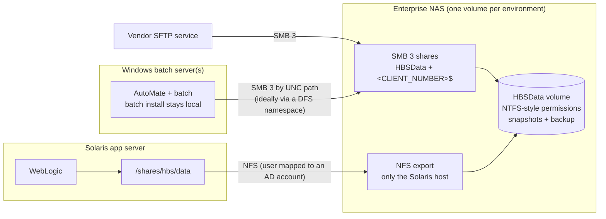

# Option D: move the HBS files to a shared NAS (SMB 3 + NFS)

Part of [smbfs-removal.md](smbfs-removal.md). The more durable alternative to
[NFS from the Windows servers](smbfs-option-nfs.md).

**In one line:** move `E:\Datafiles\HBS` onto an enterprise NAS that serves the
same folders over **SMB 3** to Windows (batch, SFTP, per-client shares) and over
**NFS** to Solaris (WebLogic). The NAS is run by a storage team with snapshots,
backups and replication. SMBv1 goes away, and HBS's files no longer live on a
batch server.

This only makes sense if CSBC/NR already has such a NAS (for example NetApp
ONTAP or Dell PowerScale) and the storage team can take the work before the
Q4 patch. The steps below are written vendor-neutrally, with NetApp terms in
brackets as an example.

Placeholders: `<nas>` (the NAS's SMB/NFS name), `<windows-batch-1/2>`,
`<windows-test>`, `<solaris-prod>` / `<solaris-test>`, `<weblogic-user>`,
`<batch-svc>`, `<sftp-svc>`, `<domain>`.

## Target picture



## Compared with NFS from the Windows servers

| | NFS from Windows ([option C](smbfs-option-nfs.md)) | Shared NAS (this option) |
|---|---|---|
| Data move | None | All of `E:\Datafiles\HBS`, Microfiche included |
| Config changes | Solaris `vfstab` only | Solaris `vfstab`, batch UNC paths, SFTP root, per-client shares |
| PROD outage | Minutes | A quiet window for the final copy (hours, depending on size) |
| Who runs it | The HBS Windows servers' owners | The storage team (snapshots, backups, replication, monitoring) |
| Single point of failure | The Windows batch server | NAS high availability |
| Records (Microfiche) | Unchanged | Can go on WORM / immutable storage (e.g. SnapLock), which helps with [Q7](questions.md) |
| Later move to OpenShift | Sync job reads from the Windows server | Sync job reads from the NAS; the batch servers can be retired independently |
| Time to deliver | Shortest | Longer; depends on the storage team's queue |

**Choose the NAS when** the storage team can deliver before the patch date (or
a deferral covers it), or when the Windows batch servers are themselves due to
be retired or rebuilt. Otherwise do the NFS option now, and consider the NAS
later as a separate, unhurried move.

## Prerequisites and decisions

| # | Item | Owner |
|---|---|---|
| 1 | A NAS in the same data centre as the HBS servers, licensed for both SMB and NFS, with capacity for `E:\Datafiles\HBS` plus growth and snapshot reserve | Storage team |
| 2 | Size and file count of `E:\Datafiles\HBS` per folder: Microfiche, XMLarchive and FTPfiles are likely the largest | Windows admins |
| 3 | Security approves NFS from the Solaris host to the NAS (`sys` auth limited to the Solaris host's address, or `krb5p`) | Security / MISO |
| 4 | Where the vendor SFTP service runs and how its users' home folders map to `FTPfiles\<client>\HBS` | Infra / App Maintenance |
| 5 | Who uses the per-client `<CLIENT_NUMBER>$` shares, and their current permissions | Windows admins |
| 6 | Whether Solaris still needs the `HBSBatch` mounts. These are the batch install folders, which stay on Windows. If Solaris needs them, NFS-export them from Windows (option C) or move the needed files onto the NAS. | App Maintenance |
| 7 | Records sign-off for moving Microfiche (verified copy, original kept read-only until sign-off) | Records / Business |
| 8 | Retention, snapshot and backup policy for each folder (see [pinch-points.md](pinch-points.md) #11) | Records + Storage |
| 9 | A DFS namespace path for the share, so later moves don't need config changes | Windows / AD admins |

## Build

### 1. NAS volume and access

- **One volume per environment** (TEST, PROD), e.g. `hbs_data_prd`.
- **NTFS-style permissions on the volume** (NTFS security style). Most consumers
  are Windows (batch, SFTP, per-client shares), so NTFS ACLs are the single
  source of truth, and NFS users are mapped onto Windows accounts.
- **Join the NAS's file server (SMB server) to `<domain>`.**
- **Shares:**
  - `HBSData` at the volume root (same name as today).
  - The per-client shares `<CLIENT_NUMBER>$` under `FTPfiles\<CLIENT_NUMBER>`, recreated with the same permissions (see "Repoint" below).
  - Require SMB 3 with encryption or signing as the storage team's standard sets.
  - **No SMB1.**
- **NFS export:**
  - Restrict access to `<solaris-prod-ip>` (or `<solaris-test-ip>`) only, read-write, root access off, auth `sys` (or `krb5p`).
  - Allow v3 and/or v4.1 depending on what Solaris supports.
  - NetApp example: an export-policy rule with clientmatch set to the Solaris host's address, `rorule=sys`, `rwrule=sys`, `superuser=none`.
- **Map `<weblogic-user>` to a Windows account**, so files WebLogic creates are
  owned by a real AD account and NTFS inheritance works. Either:
  - a name-mapping rule from Unix user `<weblogic-user>` to `<domain>\<ad-weblogic-account>`; or
  - LDAP/AD lookup using `uidNumber` and `gidNumber` on the AD account.
- **Grant NTFS *Modify*** on the volume root, inherited by subfolders, to:
  - `<batch-svc>`;
  - `<sftp-svc>`;
  - the AD account WebLogic is mapped to.

  Add the per-client permissions under `FTPfiles` as they are today.
- **Snapshots and backup:** a regular snapshot schedule (e.g. hourly and
  nightly), plus backup to the standard NR backup target. For Microfiche,
  consider a separate WORM (write-once) volume. If the storage can't do WORM,
  keep it on the main volume with tighter permissions.
- **Optional DFS namespace:** publish the share as a namespace path (e.g. `\\<domain>\<namespace>\HBSData`) and use that path everywhere. Later storage moves then only change the DFS target.

### 2. Copy the data (several passes)

Seed early and repeat. Only the final pass happens in the outage window. Run
from a Windows host with backup rights:

```powershell
robocopy E:\Datafiles\HBS \\<nas>\HBSData /MIR /COPYALL /DCOPY:DAT `
  /MT:16 /R:1 /W:1 /XJ /NP /LOG:C:\temp\hbs-copy-pass1.log
```

- **`/COPYALL` and `/DCOPY:DAT`** keep permissions, owners and **timestamps**.
  The purges delete by last-modified date (B9001/B9002 after 31 days, B9003
  after 7 days), so reset timestamps would postpone every purge.
- **Repeat until a pass copies almost nothing.** That tells you how long the
  final pass will take.
- **Verify** file counts and sizes per top-level folder (`robocopy /L` or
  `Get-ChildItem -Recurse | Measure-Object -Sum Length`) after the final pass.
  For **Microfiche**, also compare hashes on both sides (`Get-FileHash`) and
  keep the hash list as the records evidence.

### 3. Repoint everything that uses the files

| Consumer | Today | Change |
|---|---|---|
| Solaris WebLogic | SMBFS mount at `/shares/hbs/data` | `vfstab`: NFS from `<nas>` at the **same mount point**, so `HBSConfiguration.properties` doesn't change |
| Windows batch (instances 01 and 02) | Local paths or UNC paths to the Windows server's shares in `hbs_batch.*.properties` | UNC paths to `\\<nas>\HBSData\…` (or the DFS path). Keys to change: `xml.input.dir`, `xml.archive.dir`, `ftp.root.dir`, `reporting.output.directory`, `print.archive.directory`, `print.invoice.*.directory`, `statement.delivery.*.print.dir`, the processing-parameter file path, and the EDI dirs if still configured |
| Vendor SFTP service | Writes into `E:\Datafiles\HBS\FTPfiles\<client>\HBS\Inbound`, reads `Outbound` | Root or home folders on `\\<nas>\HBSData\FTPfiles\…`; `<sftp-svc>` needs NTFS rights there. **Vendors see no change.** |
| Per-client `<CLIENT_NUMBER>$` shares | Shares on the Windows server | Recreated on the NAS with the same names and permissions. Script it: export `Get-SmbShare` / `Get-SmbShareAccess` and folder permissions (`Get-Acl`) from the Windows server, then apply them on the NAS. Anyone mapping them by the old server name needs the new name, or a DNS alias. |
| AutoMate tasks | `%BATCH_HOME%\hbs\01\bin` (local batch install) | No change. Only the data paths in the properties move. |
| Windows backups | Cover `E:\Datafiles` | NAS snapshots and backup take over. Keep the old backups for the retention period. |

### 4. Test in TEST

Build a TEST volume, copy TEST data, repoint `<solaris-test>`, `<windows-test>`
batch and the TEST SFTP (if any), then run:
- the regression checklist from [smbfs-option-nfs.md](smbfs-option-nfs.md#step-6-test-in-test-then-prod);
- these NAS-specific checks:

| Check | Passes when |
|---|---|
| SFTP drop | A test vendor upload lands on the NAS, and B1011 picks it up. |
| Per-client share | A client account can open its own `<CLIENT_NUMBER>$` and **can't** open another client's. |
| B2065 FTP delivery | Statements appear in the client's `Outbound` on the NAS. |
| Batch moves | B1011/B1012 copy-then-delete between folders on the NAS work for `<batch-svc>`. |
| Snapshot restore | Restore a deleted test file from a snapshot. |
| NAS failover | Fail the NAS controller over during light use. WebLogic and batch recover without errors. |

### 5. PROD cut-over

1. **Before:**
   - final seed pass the day before;
   - announce a short pause in SFTP intake;
   - pick a window clear of the invoicing runs (B2031/B2041 at 15:00) and the 2nd-of-month purges.
2. **Freeze:**
   - disable the AutoMate tasks;
   - stop the SFTP service;
   - put a maintenance banner on the web app, or stop WebLogic.
3. **Final copy:** one more robocopy pass, then verify counts and the Microfiche hashes.
4. **Make the old side read-only:** remove write access on the old shares instead of deleting anything.
5. **Switch:**
   - batch properties (or the DFS target);
   - SFTP root;
   - per-client shares;
   - Solaris `vfstab` to NFS, then start WebLogic.
6. **Check:** run the TEST checklist quickly, then turn the AutoMate tasks and SFTP back on.
7. **Watch:** the "Batch Failure" mailbox, WebLogic logs and SFTP logs over the next few business days, including one invoicing run.

### 6. Turn off SMBv1 and clean up

- Turn SMBv1 off on the old Windows servers, close the MISO exception and clear
  the Solaris patch.
- Keep the old `E:\Datafiles\HBS` read-only until an agreed sign-off, then
  archive it per records policy.

## Rollback

| When | How |
|---|---|
| During the cut-over window | Put back the old batch paths, SFTP root and shares; restore the old write access; revert `vfstab` (SMBFS still works before the patch). Nothing was written to the NAS by users yet. |
| After go-live, before the Solaris patch | Same as above, plus copy back anything created on the NAS since go-live (`robocopy` from NAS to Windows, newer files only): new uploads, statements, report output. |
| After the Solaris patch | No SMBFS. Roll Solaris forward to NFS (from the NAS, or from Windows as in option C). |

## Risks

| Risk | Mitigation |
|---|---|
| The storage team can't deliver before the patch date | Do option C now and move to the NAS later; the NFS mount point on Solaris stays the same. |
| Missed consumer (an undocumented script, report or user mapping the old share) | Before cut-over, list active connections and open files on the old shares (`Get-SmbSession`, `Get-SmbOpenFile`) over a couple of weeks. After cut-over, read-only old shares make strays fail loudly instead of writing to the wrong place. |
| Per-client share permissions recreated wrongly (one client sees another's files) | Script the copy of permissions; TEST check that a client can't open another client's share. |
| Timestamps or permissions lost in the copy | `/COPYALL /DCOPY:DAT`; spot-check before the final pass. |
| Microfiche integrity questioned | Hash list from both sides, kept as evidence; original kept read-only until signed off. |
| Higher latency than local disk for batch | Put the NAS in the same data centre; time a B1012 and a B2031 run in TEST. |
