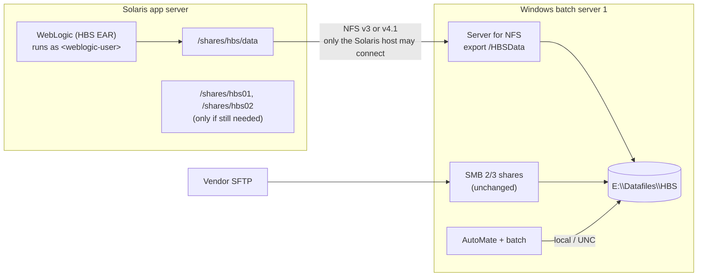

# Option C: NFS from the existing Windows servers

Part of [smbfs-removal.md](smbfs-removal.md). This is the shortest path to
keeping legacy HBS working after the 2026 Q4 Solaris patch removes SMBFS, and
to turning off SMBv1.

**In one line:** the Windows servers that already hold the HBS files also share
them over NFS, and the Solaris app server mounts them with its built-in NFS
client at the same mount points. No data moves and no application config
changes.

Placeholders: `<windows-batch-1>` / `<windows-batch-2>` (PROD Windows servers),
`<windows-test>`, `<solaris-prod>` / `<solaris-test>`, `<weblogic-user>` (the
Solaris account WebLogic runs as), `<batch-svc>` (the Windows batch service
account), `<domain>`. Real values belong in the change request, not in this repo.

## Target picture



What stays the same:
- the data and where it lives;
- the SMB 2/3 shares, the per-client `<CLIENT_NUMBER>$` shares and SFTP;
- the batch configuration and AutoMate;
- Windows backups;
- `HBSConfiguration.properties` on Solaris.

What changes:
- a new **Server for NFS** role on the Windows server(s);
- one export per mounted share;
- an identity mapping for `<weblogic-user>`;
- firewall rules;
- the Solaris `/etc/vfstab` entries;
- in the end, **SMBv1 turned off**.

## Prerequisites and decisions

| # | Item | Owner | Why it matters |
|---|---|---|---|
| 1 | Security approves NFS between the HBS Solaris servers and their Windows servers, with `sys` auth limited to the Solaris host's address | Security / MISO | Kerberos NFS (`krb5p`) is also possible, but Solaris then has to join AD and get a keytab, which adds time. |
| 2 | Why was NFS ruled out in 2024? | Infra / Mid-tier | Make sure that reason no longer applies. |
| 3 | Windows Server version on each HBS Windows server | Infra | Server for NFS is a built-in role on Windows Server 2012 and later, which serve NFS **v3 and v4.1 only (not v4.0)**. |
| 4 | Which NFS versions the Solaris client supports | Solaris Support | If Solaris can't do v4.1, use **v3**. Windows won't serve v4.0. |
| 5 | Uid and gid of `<weblogic-user>` on each Solaris server (`id <weblogic-user>`) | Solaris Support | Needed for identity mapping. |
| 6 | Whether Solaris still needs the `HBSBatch` mounts (`/shares/hbs01`, `/shares/hbs02`) | App Maintenance | Each one still needed is another export. If nobody knows, export them anyway in TEST and watch. |
| 7 | Is `microfiche.xml.extend` on in PROD? | App Maintenance | Decides whether an invoicing run is part of the regression test. |
| 8 | Patch deferral long enough to finish TEST, then PROD | Solaris Support | Rollback relies on SMBFS still existing (see Rollback). |

## Step 1: find out who else uses SMBv1 (start now)

This carries no risk and runs alongside everything else. On each HBS Windows
server:

```powershell
Set-SmbServerConfiguration -AuditSmb1Access $true -Force
# then review, after 1–2 weeks:
Get-WinEvent -LogName Microsoft-Windows-SMBServer/Audit |
  Select-Object TimeCreated, Message
```

The aim is a list in which the only SMBv1 clients are the HBS Solaris servers.
If anything else shows up, it has to move to SMB 2/3 before Step 7.

## Step 2: firewall

From the Solaris app server to the Windows server(s):
- **NFS v4.1:** TCP 2049 only.
- **NFS v3:** TCP/UDP 111 (portmapper), 2049 (NFS), plus Windows' mount, lock
  and status ports (by default 1048, 1047 and 1039; confirm on the server).

No other host should reach these ports.

## Step 3: Windows — add the NFS export

```powershell
Install-WindowsFeature FS-NFS-Service -IncludeManagementTools

# Export with no default access, then allow only the Solaris host.
New-NfsShare -Name HBSData -Path 'E:\Datafiles\HBS' `
  -Authentication sys -Permission no-access `
  -AllowRootAccess $false -EnableUnmappedAccess $false

Grant-NfsSharePermission -Name HBSData `
  -ClientName <solaris-prod-ip> -ClientType host `
  -Permission readwrite -AllowRootAccess $false

Get-NfsSharePermission -Name HBSData   # expect only the Solaris host
```

Repeat for the `HBSBatch` folders on each server if Solaris still needs them.

The SMB shares on the same folders stay as they are. NTFS permissions apply to
NFS access as well, so they stay the single source of truth for who can do what.

## Step 4: identity mapping (the part to get right)

Every file the Solaris side creates or changes must end up owned by and
accessible to the right Windows identities, and the reverse:
- **Solaris → Windows:** a web upload written into XMLinput by WebLogic must be
  readable and deletable by `<batch-svc>`, because B1012 moves it to XMLarchive.
- **Windows → Solaris:** ProcessParam files written on Windows must be readable,
  and writable for P038 saves, by `<weblogic-user>`. Report output must be
  readable.

**Preferred: map `<weblogic-user>` to an AD account.**
1. Choose (or create) an AD service account for HBS WebLogic. Give it NTFS
   *Modify* on `E:\Datafiles\HBS`, inherited by subfolders. That's the same
   level of access the SMBFS mount account has today.
2. On that AD account, set `uidNumber` and `gidNumber` to the Solaris uid and gid
   of `<weblogic-user>`. Set `gidNumber` on a matching AD group as well. These
   are the standard RFC 2307 attributes already in the AD schema.
3. Point Server for NFS at AD:
   ```powershell
   Set-NfsMappingStore -EnableADLookup $true -ADDomainName <domain>
   Get-NfsMappedIdentity -AccountName <ad-weblogic-account> -AccountType User
   ```

   Files WebLogic creates are then owned by a real Windows account, and normal
   NTFS inheritance gives `<batch-svc>` its access.

**Alternatives if AD attributes can't be changed:**
- **Local mapping files:** Server for NFS can read standard `passwd` and `group`
  files in `%SystemRoot%\System32\drivers\etc` that map the uid and gid to a
  local or domain account. Confirm on the server's Windows version.
- **Unmapped UNIX access** (`-EnableUnmappedAccess $true`): Windows records the
  Unix uid and gid as special SIDs (`S-1-5-88-…`) on new files. This works only
  if NTFS inheritance on every folder still gives `<batch-svc>` *Modify*.
  Mixed-ownership files are harder to audit, so use it as a last resort.

The uid and gid can differ between TEST and PROD. Map each environment
separately.

## Step 5: Solaris — mount over NFS at the same paths

Check what's exported, then test at a scratch path first:

```sh
showmount -e <windows-batch-1>            # v3 only; shows /HBSData
mkdir -p /mnt/nfstest
mount -F nfs -o vers=3,proto=tcp,hard,rw <windows-batch-1>:/HBSData /mnt/nfstest
```

Check as `<weblogic-user>`:
1. Read an existing file.
2. Create a file, rename it, then delete it.
3. Create a file in `XMLinput/<client>/` and confirm from Windows that
   `<batch-svc>` can open it and delete it.
4. Write a mixed-case filename and confirm it looks the same from both sides.
5. Check that timestamps look correct from both sides.

Then replace the smbfs lines in `/etc/vfstab` with NFS lines **at the same
mount points**, keeping the old lines commented out for rollback:

```
#<windows-batch-1>/HBSData  -  /shares/hbs/data  smbfs  -  yes  ...   (old)
<windows-batch-1>:/HBSData  -  /shares/hbs/data  nfs    -  yes  vers=3,proto=tcp,hard,rw
```

Use `vers=4.1` (and drop the v3 firewall ports) if Solaris supports it. Use
`hard` mounts: if the Windows server reboots, file calls wait and resume
instead of failing halfway through a write. That's the same behaviour as
today's mount.

Unmount smbfs, mount NFS, restart WebLogic.

## Step 6: test in TEST, then PROD

**TEST** (`<solaris-test>` with `<windows-test>`; one Windows server)

| Check | Passes when |
|---|---|
| Web XML upload (P505) | File lands in `XMLinput/<client>/`. The next B1011/B1012 run picks it up and moves it to XMLarchive. |
| Processing Parameters (P038) | Save, re-open and see the values. B2031/B2041 read the new start location and time limit. |
| Alert banner | Change it on P038; it shows on every page. |
| Report drop (P410 or equivalent) | Output appears and its link works. |
| Microfiche (if on) | An invoicing run in TEST writes the statement XML to Microfiche without errors. |
| Purges | B9002 still deletes old report output, so timestamps are being read correctly. |
| Windows reboot | Reboot `<windows-test>` during light use. WebLogic requests wait and then recover; no files are corrupted. |

**PROD**
- **Window:** minutes. Remount and restart WebLogic.
- **Timing:** avoid the invoicing runs (B2031/B2041 at 15:00) and the
  2nd-of-month purges ([legacy-batch.md](legacy-batch.md)). Batch keeps running;
  its access doesn't change.
- **After the swap:** repeat the TEST checklist, then watch the "Batch Failure"
  mailbox and WebLogic logs for a few days.

## Step 7: turn off SMBv1

Do this once PROD has been stable for an agreed period and the Step 1 audit
shows no other SMBv1 clients:

```powershell
Set-SmbServerConfiguration -EnableSMB1Protocol $false -Force
# Windows Server 2016+: also remove the feature
Uninstall-WindowsFeature FS-SMB1
```

Then close the **MISO exception** and tell Solaris Support the HBS servers are
clear to patch.

## Rollback

| When | How |
|---|---|
| Before SMBv1 is off and before the Solaris patch | Restore the commented smbfs lines in `/etc/vfstab`, remount, restart WebLogic. No data to reconcile, because the files never moved. |
| After SMBv1 is off, before the patch | Turn SMBv1 back on (`-EnableSMB1Protocol $true`), then as above. |
| After the Solaris patch | No SMBFS rollback exists. Fix NFS forward. This is why TEST must be done before the patch date. |

## Risks

| Risk | Mitigation |
|---|---|
| Security won't approve NFS with `sys` auth | Offer Kerberos (`krb5p`) or the NAS option ([smbfs-option-nas.md](smbfs-option-nas.md)), which a storage team runs under its own controls. |
| Identity mapping leaves files the other side can't touch | Step 5 checks 3 and 4 in TEST. Fix with NTFS inheritance and the AD mapping. |
| Something else still uses SMBv1 | Step 1 audit; move it before Step 7. |
| The PROD Windows server is a single point of failure | Unchanged from today. The NAS option addresses it. |
| Windows patch reboots stall the web tier | Same as today with SMBFS. Schedule Windows patching outside business hours. |

## Effort

The infrastructure work is small: one Windows role, one or a few exports, one
identity mapping, a firewall rule and a `vfstab` change per environment. The
timeline is set by the **approvals** (Security for NFS, firewall change
requests, AD attribute changes) and the **TEST regression**, not by the build.
