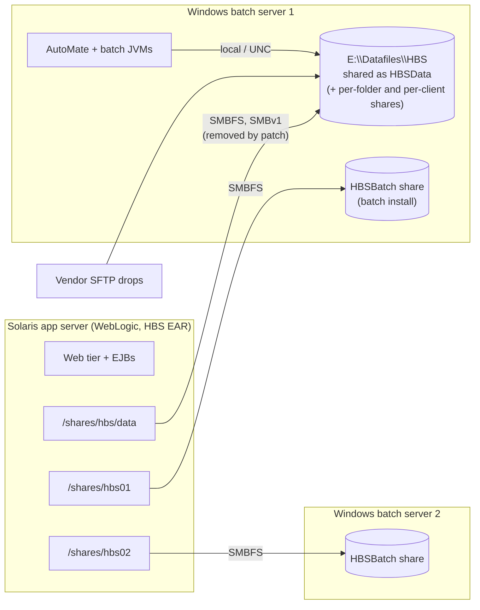

# SMBFS removal on Solaris (2026 Q4): legacy HBS impact and options

**Status:** open. This is a decision for Solaris Support, Infra/Mid-tier,
Application Enablement, Application Maintenance and the business, and it needs
to be made **before the 2026 Q4 Solaris patching cycle**.

This is about keeping the **legacy** HBS running until cut-over. The new app
doesn't use SMB at all (see [file-shares-and-storage.md](file-shares-and-storage.md)),
but it won't be in production before the patch lands.

Server names, share names and service accounts are kept out of this repo on
purpose. They are in the infrastructure notice and the meeting notes.

## Background

- Oracle removed **SMBFS** (the Solaris SMB *client* filesystem) in the Solaris
  patch bundle scheduled for the 2026 Q4 patching cycle. There is no direct
  replacement.
- Two CSBC/NR applications depend on it: **HBS** and BMIS (Lands). Both run on
  Solaris and use SMBFS mounts to exchange files with Windows servers.
- **This has happened before.** In 2024, a Windows SMB change stopped SMBFS
  working. No alternative was found, so a **MISO exception** re-enabled
  **SMBv1** on the affected Windows servers. That exception stops helping once
  the Solaris servers are patched, because the client side is gone.
- Affected Solaris servers: one each in DLVR, TEST and PROD. HBS has two working
  environments: **PROD** (Solaris app server plus two Windows batch/file
  servers) and **TEST** (Solaris app server plus one Windows server).
  Confirm whether DLVR is HBS, BMIS or both.

## Where HBS's files actually are

- **The data lives on Windows.** `E:\Datafiles\HBS` holds XMLinput, XMLarchive,
  FTPfiles (`<client>\HBS\Inbound|Outbound`), ReportingOutput, ProcessParam,
  Microfiche and the print folders (`hba-archive/hbs/trunk/documentation/file_shares.txt`).
  The batch jobs on Windows use it locally or by UNC path, so **batch itself is
  not affected by the patch**.
- **The web tier on Solaris uses four of those folders through the SMBFS mount**
  (`HBSConfiguration.properties`):

  | Folder | What breaks on Solaris when the mount goes |
  |---|---|
  | XMLinput | Web XML upload (P505) can't store submissions |
  | ProcessParam | Processing Parameters screen (P038), and the alert banner read on every page (`RetrieveAlertTextTag`) |
  | ReportingOutput | Report drops and e-mailed report links (P410) |
  | Microfiche | The legal archive copy of statements, written by the EJB during invoicing (B2031/B2041) when `microfiche.xml.extend` is on. If it's on, **invoicing could fail.** |

- **The two `HBSBatch` mounts** (`/shares/hbs01`, `/shares/hbs02`) line up with
  batch instances `01` and `02` (one per Windows server). What the Solaris side
  uses them for (logs, conf, hand-offs) isn't recorded in the source. Ask
  Application Maintenance; if nothing uses them, drop them.

## Options

| | Option | What changes | Pros | Cons / risks |
|---|---|---|---|---|
| A | **Defer patching** (exemption) | Nothing | Buys time to test B or C properly | Only delays. The Solaris server stays unpatched, and the SMBv1 exception continues. |
| B | **Reverse the direction**: move the data to Solaris and export it over SMB 2/3 to Windows | Data moves to Solaris disk (ZFS). Solaris's SMB **server** exports it. Windows batch mounts it by UNC. | Solaris reads locally. SMBv1 can be turned off, retiring the MISO exception. | The most moving parts (see below). Confirm the patch removes only the SMB *client*, not the SMB server. |
| C | **NFS from the existing Windows servers**: [runbook](smbfs-option-nfs.md) | Windows Server enables "Server for NFS" on the existing folders. Solaris mounts them with its native NFS client at the same mount points. | No data move. SFTP drops, per-client shares, batch paths and Windows backups are untouched. The app config doesn't change. Minutes of outage. SMBv1 can be turned off. | It was ruled out in 2024 for unknown reasons; check whether those still apply. Needs Security approval for NFS, identity mapping for the WebLogic user, and firewall rules. The Windows server stays a single point of failure. |
| D | **Move the files to a shared NAS** (SMB 3 to Windows, NFS to Solaris): [runbook](smbfs-option-nas.md) | Data moves to an enterprise NAS volume. Batch, SFTP and the per-client shares use SMB 3; Solaris uses NFS at the same mount points. | Run by a storage team (snapshots, backup, high availability). Microfiche can go on WORM storage. SMBv1 can be turned off. The data no longer lives on a batch server. | Needs an existing NAS and the storage team's time. Data copy and a quiet window. SFTP, per-client shares and batch paths are all repointed. |
| E | **Keep files local, sync only what crosses** | Folders only the web tier uses become local Solaris disk; folders both sides use get a frequent one-way copy (SFTP or rsync). | No shared filesystem, no NFS approval. | Near-real-time instead of instant; needs settle rules and a per-folder read/write analysis of the legacy code (not done yet). |
| F | **Move WebLogic off Solaris onto Linux** | Re-host the HBS EAR on RHEL; Linux mounts the shares over SMB 3. | Removes Solaris from HBS. | A re-platform of a legacy WebLogic 10.3.6 stack: lots of effort for something the modernization replaces. |
| G | **Replace the SMB dependency in the app** | Code changes in the legacy EAR | n/a | Not realistic for a legacy Struts/EJB 2 app in the time available. The modernization (OpenShift plus object storage) is the real exit, and it removes Solaris altogether. |

**Recommendation for Monday:**
1. Ask for a **short deferral** (A), long enough to run one option end to end in TEST.
2. **Default to C (NFS from Windows).** It changes the least: one mount type on one side, and the data, SFTP, backups and batch stay where they are.
3. **Choose D (NAS) instead** if a NAS with both SMB and NFS exists and the storage team can deliver before the patch (or the deferral covers it). Otherwise do C now and consider D later as a separate move; the Solaris mount point stays the same either way.
4. Fall back to B, E or F only if NFS is refused outright.

Whichever is chosen, keep the folder layout as it is. The planned move to
OpenShift reads the same `<client>/HBS/Inbound|Outbound` layout through a sync
to object storage ([file-shares-and-storage.md](file-shares-and-storage.md)).

### If B is chosen: things the plan must cover

The draft plan (confirm locations, prepare Solaris storage, copy, export over
SMB 2/3, set up batch service account access, test in TEST, cut over, keep the
Windows shares for rollback) is sound. These HBS-specific items need adding:

1. **Everything that writes to the shares has to follow the data**, not only the batch jobs:
   - the **vendor SFTP service** that drops files into `FTPfiles\<client>\HBS\Inbound`, and where it runs;
   - the **per-client `<CLIENT_NUMBER>$` shares** and their ACLs (about 69 clients), if anyone still maps them;
   - B2065's FTP delivery into `Outbound`.

   Find out who uses the per-client shares before moving anything.
2. **Keep file timestamps.** The purge jobs delete by last-modified date: B9001 and B9002 after 31 days, B9003 after 7 days ([legacy-batch.md](legacy-batch.md)). A copy that resets timestamps delays purges by a month. Use `robocopy /COPY:DAT /DCOPY:T` or equivalent, and compare counts and checksums.
3. **Keep the mount paths on Solaris.** Mount the new ZFS datasets at `/shares/hbs/data`, `/shares/hbs01` and `/shares/hbs02`, so `HBSConfiguration.properties` doesn't change. On Windows, only the UNC paths in `hbs_batch.*.properties` change: `xml.input.dir`, `xml.archive.dir`, `ftp.root.dir`, `reporting.output.directory`, the print directories, and the processing-parameter path.
4. **Identity.** The Solaris SMB server must join the IDIR domain, with idmap set up, so the batch service account (and the SFTP service account) can read, create, rename and delete files. Batch moves files by copy-then-delete.
5. **Backups and records.** Windows backups cover `E:\Datafiles` today; Solaris needs equivalent snapshots and backups first. **Microfiche is the legal archive.** Moving it needs records sign-off and a verified copy (checksums), and the original kept read-only until signed off ([pinch-points.md](pinch-points.md) #11).
6. **Cut-over quiet window.** Pause all of these, then run the final sync:
   - the AutoMate tasks (see the schedule in [legacy-batch.md](legacy-batch.md); avoid invoicing at 15:00 Mon–Fri and the 2nd-of-month purges);
   - the vendor SFTP intake;
   - web uploads.
7. **TEST first.** TEST has a single Windows server; PROD has two. Rehearse the two-mount layout before PROD.
8. **Rollback.** Keep the Windows shares unchanged but read-only after cut-over, and know how to point the configs back.

## Questions to settle at the meeting

1. Does the patch remove only the SMB client (`smbfs`), or the Solaris SMB server too? Which SMB versions does the Solaris SMB server support?
2. Can the HBS Solaris servers get a patch deferral, and for how long?
3. Is NFS between Solaris and these Windows servers acceptable (option C), and why was it ruled out in 2024?
4. Which host runs the vendor SFTP service, and what does it write to?
5. Who uses the per-client `<CLIENT_NUMBER>$` shares and the `HBSBatch` mounts on Solaris?
6. Is `microfiche.xml.extend` on in PROD? If it is, a broken Microfiche mount affects invoicing.
7. Is the DLVR Solaris server HBS, BMIS or both?
