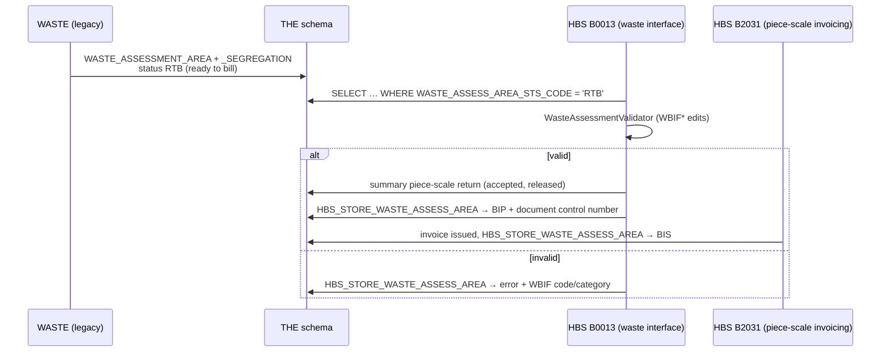

# WASTE ↔ HBS integration API (proposal)

**Status: draft proposal — not built, not signed off.** Input to the Waste Plus
integration contract (bcgov/nr-waste-plus#1213, dependencies HBS-01..08).
Everything below is HBS's proposed side of that contract; rows the WASTE team
and PO haven't agreed stay open (see [Decisions needed](#decisions-needed)).

## Background: how legacy does it

WASTE is a separate application. It hands work to HBS through the shared `THE`
schema, not an API; HBS polls.



Facts the API keeps (checked in `hba-archive`):

| Item | Legacy behaviour |
|---|---|
| Status column | `WASTE_ASSESS_AREA_STS_CODE`: **RTB** (set by WASTE) → **BIP** billing in progress (B0013, validation passed) → **BIS** billing issued (B2031 `WasteAssessmentManager.extend`), or an error status |
| Keys | `WASTE_ASSESSMENT_AREA_ID`; `DOCUMENT_CONTROL_NUMBER` links to the HBS summary return and is kept on success (cleared only on failure) |
| Segregations | `WASTE_ASSESSMENT_SEGREGATION`: species / product / grade, `ESTIMATED_VOLUME`, `AVOIDABLE_IND`, `NUMBER_OF_PIECES` |
| HBS writes | only through `HBS_STORE_WASTE_ASSESS_AREA(id, status, dcn, user, error code, category)` and the summary-return create path; HBS's role has **SELECT only** on the two waste tables |
| Edits | `WasteAssessmentValidator`: WBIF00 (duplicate mark + cut block + survey date), surveyor licence, timber mark has a billed client (`MARK_BILLED_CLI`), cut block belongs to mark, species/product/grade in `SPECIES_PRODUCT_GRADE_XREF`, waste residue rate exists, date limits |
| Invoice | the normal piece-scale invoice (PSI); its stylesheet has a waste section |

The modernized WASTE (Waste Plus) wants a REST contract instead. HBS's own
port of B0013 is needed either way ([batch-jobs.md](batch-jobs.md): 🔴 not
ported); both the poller and the API below should call one shared service so
there is no duplicate logic, and the poller keeps legacy WASTE working during
cutover.

## Conventions

- Base path: `/api/v1/hbs/integrations/waste`
- Auth: Keycloak **client-credentials** token for a Waste Plus service account
  with a dedicated role (e.g. `HBS_WASTE_INTEGRATION`); user tokens are refused.
  The client and role are set up by the team / Keycloak admins.
- JSON; dates `YYYY-MM-DD`, months `YYYY-MM`, America/Vancouver.
- Errors: `{ "code": "WBIF23", "category": "…", "message": "…", "field": "…" }`,
  using the legacy WBIF codes so both systems speak the same taxonomy.

## Family A — queries and validation (HBS-01..03)

| # | Method / path | HBS-# | Purpose |
|---|---|---|---|
| A1 | `GET /billing-history?timberMarks=&from=YYYY-MM&to=YYYY-MM` | 01 | Mark Monthly Billing History rows: species, product, grade, volume, value, billing type. Reuses the existing `harvestHistory.billing` query (screen parity). |
| A2 | `GET /timber-marks/{mark}/species-composition?plcDate=` | 01, 02 | Species (and grade) volume + % over the date window. **HBS computes the window** — 12 months ending the last day of the month after PLC — and echoes it (`window.from`, `window.to`, `window.rule`). No history → `200` with `dataAvailable: false`, never `404`. |
| A3 | `GET /timber-marks/{mark}/validation?clientNumber=&district=&cutBlockId=` | 03 | Mark / licensee / district / cut-block association, legacy rules. Returns `{ valid, errors[] }`. |
| A4 | `GET /residue-rates?timberMark=&cutBlockId=&date=` | supports 03/04 | Waste & residue rates in effect on a date (legacy rejects an assessment with no rate). |
| A5 | `GET /codes/species-product-grade` | supports 04 | Valid species / product / grade combinations, cacheable. |

## Family B — billing submission and status (HBS-04..08)

| # | Method / path | HBS-# | Purpose |
|---|---|---|---|
| B1 | `POST /assessments:validate` | 03, 04 | Dry run of the full submission body: every WBIF error, nothing written. Lets Waste Plus fail fast at approval time, not after the nightly run. |
| B2 | `POST /assessments` + header `Idempotency-Key: <Waste Plus outbox eventId>` | 04, 05, 07, 08 | Submit an approved District Average / WAA block (body below). Recorded as **RTB** for HBS's billing job → `202 { submissionId, externalId, status: "READY_TO_BILL" }`. |
| B3 | `GET /assessments/{submissionId}` | 06 | Status plus HBS references (table below). |
| B4 | `GET /assessments?externalId=` or `?idempotencyKey=` | 07 | Read-after-timeout: *applied* (returns the record) or *not applied* (`404`). With HBS deduping on the key there is no *indeterminate* outcome. |
| B5 | `GET /assessments?status=&updatedSince=` | 06 | Batch polling instead of one call per block. |
| B6 | `POST /assessments/{submissionId}:withdraw` | 08 | Optional: pull a submission back while still RTB; `409` once HBS has picked it up. |

### Submission body (B1 / B2)

```json
{
  "externalId": "waste-plus-block-id",
  "timberMark": "AB123",
  "cutBlockId": "12-3",
  "surveyDate": "2026-09-30",
  "wasteSurveyorLicence": "1234",
  "reportingUnitId": 456,
  "forestFileId": "A12345",
  "parentExternalId": null,
  "segregations": [
    {
      "speciesCode": "FI",
      "productCode": " ",
      "gradeCode": "Y",
      "estimatedVolume": 12.345,
      "avoidable": true,
      "numberOfPieces": 0
    }
  ]
}
```

Field set mirrors `WASTE_ASSESSMENT_AREA` / `WASTE_ASSESSMENT_SEGREGATION`;
final names and which are required come out of #1213.

### Duplicate and partial posts (HBS-07, HBS-08)

| Case | Response |
|---|---|
| Same `Idempotency-Key`, same body | `200` with the original result (no second submission) |
| Same `Idempotency-Key`, different body | `409` |
| New key, but an active submission for the same mark + cut block + survey date | `409` with WBIF00 |
| Body fails validation | `422` with every WBIF error; nothing recorded |

One block (area + its segregations) is one transaction: all of it or none of
it. There are no partial posts.

### Status mapping (B3 / B5)

| HBS code | API status | Terminal | Extra fields |
|---|---|---|---|
| RTB | `READY_TO_BILL` | no (Waste Plus's responsibility ends here per #1213) | — |
| BIP | `BILLING_IN_PROGRESS` | no | `documentControlNumber` |
| BIS | `BILLED` | yes | `statementNumber`, `issueDate` |
| error | `REJECTED` | yes — fix and resubmit with a new key | `errors[]` (WBIF code, category, message) |
| — | `WITHDRAWN` | yes | — |

## Mapping to #1213

| HBS-# | Dependency | Covered by | Open? |
|---|---|---|---|
| HBS-01 | Species composition / billing history | A1, A2 | response field list to confirm |
| HBS-02 | Date window | A2 (server-side rule, echoed) | confirm the rule against HBS documentation |
| HBS-03 | Mark / licensee / district validation | A3, B1 | FTA vs HBS ownership of each check |
| HBS-04 | Receive approved DA/WAA data | B2 (+ B1) | storage decision (below) |
| HBS-05 | Place data for HBS processing | B2 → RTB → HBS billing job | job schedule |
| HBS-06 | Billing status | B3, B5 | polling interval vs job schedule |
| HBS-07 | Correlation | `externalId`, `Idempotency-Key`, B4 | storage decision (below) |
| HBS-08 | Partial / duplicate / ambiguous | duplicate table, B6 | remediation process for `REJECTED` |

## Decisions needed

1. **Where a submission is stored.** HBS can't insert into the waste tables
   today. Either:
   - new nr-mof-db procs (DDL in [db/](db/)) to create the area and
     segregations, plus a place for `externalId` and the idempotency key (a
     column, or a small `HBS_WASTE_SUBMISSION` table) — needed for HBS-side
     dedupe and B4; or
   - Waste Plus keeps writing `THE.WASTE_ASSESSMENT_*` itself and B2 is a thin
     "process `{id}`" call, with dedupe left to Waste Plus's outbox.

   Recommended: HBS dedupes on the key (first option). This answers #1213's
   "does HBS dedupe by a client-supplied key" question.
2. **Freshness.** A1/A2 read live billing history (updates as invoices issue).
   Statuses move when HBS's billing job runs (B0013, then B2031 for `BILLED`);
   polling faster than that schedule gains nothing. The agreed schedule sets
   the expected time to `BILLED`.
3. **Limits.** A1 keeps the legacy cap (fewer than 5,000 rows); modest rate
   limits, since this is system-to-system.
4. **Notification.** Polling (B3/B5) only, or also a callback to Waste Plus on
   `BILLED` / `REJECTED`.
5. **Cutover.** Whether legacy WASTE and Waste Plus both submit during the
   transition (the B0013 poller and the API then run side by side).
